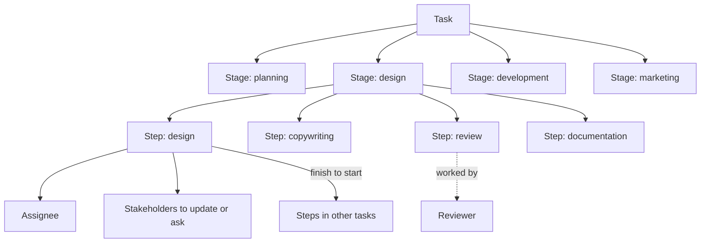

# Planning Board and Roadmap Simulation

A way for a team to try changes to a project plan in a meeting, see everything that moves, and commit the version they choose. Includes the decision record that keeps the reasons next to the work.

Status **requirements draft, prototype on fake data**Date **19 Oct 2026****58** requirements · **21** acceptance examples · **2** plans

[What I need from you](#ask)[Try the prototype](#prototype)[Why this exists](#why)[The work model](#model)[Simulation requirements](#sim)[Views by role](#roles)[Decision record](#record)[Decisions made](#decisions)[Open questions](#open)

## What I need from you

Four things block or shape the next step. Short answers are enough.

1. **Which rendering should lead?** The flat Gantt, the 3D scene, or the flat Gantt with 3D as an optional lens. The prototype has all three.
2. **Working days or calendar days?** The prototype counts duration in calendar days and capacity in weekdays. The product has to pick one.
3. **How do you re-plan today?** I could not verify the current workaround, so the prototype was judged without that comparison.
4. **A task with steps in different sprints.** Which sprint's board shows it, and which sprint's velocity does it count toward?

## Try the prototype

An interactive page on made-up data for a project called OAK. Nothing connects to DataBonder. It opens in a new tab and needs the same access as this page. Your edits are saved in your own browser only, so nobody else sees them and they are not lost on reload.

[Open the interactive prototype](https://claude.ai/artifact/WXayrKBfUKWU1GdcmPYALu)

1. Drag any step in the Gantt. A scenario is created for you and every dependent step, sprint, and risk updates while you drag.
2. Click a step to edit its dates, people, stakeholders, and dependencies, or to add a note.
3. Switch to **3D flow**. Orbit by dragging empty space. Drag a box along the floor to move it in time, or onto another person's lane to reassign it.
4. Look at **Capacity per day** under the Gantt and the **Workload** and **Efficiency gaps** panels. Red means two steps at once.
5. Tick "Sam (reviewer) out", then watch the contract risks. Move the date on the **4D** tab to see warnings become expired.
6. Create a second scenario, press **Compare**, then **Commit** one.

## Why this exists

Today a task has one status from four fixed values, one assignee, and watchers. Dependencies exist in the data, but no screen sets or shows them. Sprint is only a filter over milestones, there is no timeline view, and there is no availability data for people. When a date slips, nothing shows what else moves.

Real work does not move as one bar. A design stage contains copywriting, review, and documentation, run on different dates by different people, each with their own reviewers and stakeholders to update. Planning meetings are collective, so the simulation has to let several people argue over more than one alternative at once.

Agents already pull and write tasks over MCP in the team's own use. They lose what the previous session decided and why. The decision record in this brief fixes that, and the simulation writes its commit reason into it.

## The work model

One task travels every stage. Each stage holds steps. The step is what gets scheduled, assigned, reviewed, and linked.

PlanningDesignDevelopmentMarketing

## Simulation requirements

Thirty-four requirements, grouped by concern.

### Work model

| R1 | A task travels an ordered list of stages, defaulting to planning, design, development, and marketing, and the tenant owner maintains the list per project type. |
| --- | --- |
| R2 | A stage holds ordered steps from a template per project type, for example scope and review in planning; design, copywriting, review, and documentation in design; build, QA, and release in development; draft, review, and send in marketing; a task can edit its steps. |
| R3 | Each step has its own status, start date, duration, assignee, reviewer, and stakeholders to update or consult. |
| R4 | A review or QA step is worked by the stage's reviewer and counts toward that person's load. |
| R5 | A task's headline status, start, and end derive from its steps, so existing views keep working. |
| R6 | Sprint and release are containers with dates and capacity, and a step belongs to the sprint its end date falls in. |

### Dependencies

| R7 | A step starts no earlier than the day after the steps it depends on end, and each step depends on the previous step in its task by default. |
| --- | --- |
| R8 | A person can add or remove a dependency between steps of different tasks from a step's editor or by connecting two steps, and a link that would create a cycle is refused with the reason. |
| R9 | The step chain inside a task cannot be unlinked, only re-timed. |

### Scenarios

| R10 | The plan opens as a read-only baseline, and the first edit, or an explicit action, creates a named scenario that holds only the changes made. |
| --- | --- |
| R11 | Within a scenario a person can move a step, change its duration, reassign it, change its reviewer or stakeholders, add or remove a link, mark a person out for a period, and move a sprint boundary. |
| R12 | After every change, including mid-drag, the dates of all dependent steps, sprint membership, risks, workload, and the stakeholder list recalculate and display. |
| R13 | A moved step shows where it was and by how many days it moved. |
| R14 | Several scenarios can exist at once, and the team switches between them and opens a side-by-side comparison. |
| R15 | The comparison reports, per scenario: steps and tasks moved, largest slip, sprint spills, critical and expired risks, warnings, readiness date against each contract and release milestone, sprints over capacity, overcommitted person-sprints, idle person-days, waiting days between steps, and stakeholders to update. |
| R16 | Committing a scenario writes all of its changes to the real tasks in one action, requires a reason, appends a decision entry carrying that reason to each moved task, and lists the stakeholders to update. |
| R17 | A person can undo changes one at a time, reset a scenario, and discard it. |
| R18 | Scenarios persist across reloads and are visible to the whole team. |

### Risk

| R19 | Each scenario is evaluated against the contract date rules DataBonder already holds (COD cascade, LC non-renewal notice, LC step-up window) and against internal release dates, as of a date that a person can move. |
| --- | --- |
| R20 | A finding uses the severity vocabulary critical, warning, expired, and informational, and names the rule, the task, and the days over or short. |
| R21 | Milestones appear on the timeline as dated lines, and a task can be marked as gating one. |
| R22 | A step that spills out of its sprint, and a sprint over its capacity, are warnings. |

### Capacity and efficiency

| R23 | Per person and per working day, load is the number of steps active that day, two or more is overcommitted, zero inside a sprint is idle, and days marked out are excluded. |
| --- | --- |
| R24 | Team utilization per day is the steps active divided by the people available that day. |
| R25 | A people-by-sprint table shows step-days assigned over working days available, flagged above 100 percent or when two steps share a day, and flagged below 50 percent. |
| R26 | An efficiency list names every wait of two days or more between consecutive steps of a task, with its cause: a dependency, a person being out, or a planned gap. |
| R27 | A person's availability comes from an entered out period in this version. |

### Views and interaction

| R28 | The flat Gantt expands tasks into steps, colours bars by stage with reviewer steps patterned, draws links, shows each moved step's baseline ghost, shows sprint load on the axis, milestone lines, an as-of line, and a per-day capacity strip under the board. |
| --- | --- |
| R29 | The 3D view draws stages as floors, lanes of people or tasks running back in depth, time along each floor, steps as boxes, links crossing floors, milestones as walls, and over, idle, and out days as marked slabs on a person's lane, with orbit and zoom. |
| R30 | In the 3D view a person drags a box along the floor to move it in time and across lanes to reassign it. |
| R31 | The 4D view is the 3D view plus an as-of date scrubber that re-evaluates date rules and a replay that steps through a scenario's edits as motion. |
| R32 | Every view supports zoom, pan, keyboard moves, and a click-to-edit panel for a step that recalculates live. |
| R33 | Each role reads the plan in the view built for its question, listed below. |
| R34 | An agent reads steps, people, scenarios, and risks over MCP and can create or edit a scenario under its owner, and only a person commits one. |

## Views by role

Each role reads the same plan through the view built for its question.

| Role | Question it brings | View |
| --- | --- | --- |
| Individual contributor | What is mine next, what is blocked and on whom | Rail queue grouped by what to do next |
| Reviewer | What is waiting on my sign-off, with the handoff beside it | Rail queue regrouped by sign-off |
| Project lead | Where does each item sit across stages, what is aging | Pivot board with stage lanes and pivot control |
| Planning team | If this moves, what else moves | The simulation, flat and 3D |
| Stakeholder or exec | Is the release on track, what is at risk | Stage-by-sprint matrix, risk list |
| Tenant owner | Which stages, steps, and roles exist per project type | Template editor |
| Agent | The same question as a contributor, as one bundle | MCP read |

## Decision record

A short human-readable record per task, with the decision, the reason, what changed, and open questions, plus linked reference copies for agents. It is stored on the task and mirrored into the repository as one immutable file per entry, so merges never conflict and the format works with or without DataBonder.

### Record format

| R1 | The record is an open, documented, plain-text file format that a person can read without DataBonder, with a format version on every entry. |
| --- | --- |
| R2 | Each entry carries exactly these front-page fields: decision, why, what changed, open questions, who wrote it, the stage label, the time, the entry id, and the id of any entry it supersedes. |
| R3 | The record holds only decisions and handoffs, where a handoff is an entry of kind "handoff" with the same fields written when a stage is left; comments and worklogs are not entries. |
| R4 | The front page is the ordered list of a task's live entries, rendered so a person reads the task's current decisions on one screen, with superseded entries folded rather than deleted. |
| R5 | An entry may carry reference links to transcript excerpts, commits or diffs, and evidence such as documents, extracted tables, or findings, stored as references the task holds. |

### Writing

| R6 | An entry is immutable once stored; a correction is a new entry naming the entry it supersedes. |
| --- | --- |
| R7 | An entry attaches to the one task that travels every stage, with a stage label chosen from the project's list of stage names. |
| R8 | An entry written by an agent records the agent name and session id together with the person whose token authorized it, and the task shows the entry under that person with an agent marker. |
| R9 | Only a project member allowed to manage tasks, or an agent session acting under such a member's token, can write an entry. |
| R10 | A write over MCP returns the canonical bytes of the stored entry and the path convention for its repository file, so the writer commits exactly what DataBonder holds. |
| R24 | An agent session asks its human owner for approval once, before its first entry write in that session, and later entries in the same session are stored without a prompt. |

### Repository mirror

| R11 | When the tenant owner enables the mirror for a project, each entry is one immutable file in a per-task folder at a documented conventional location in the repository, named by task key and entry id, with no hand-maintained index file. |
| --- | --- |
| R12 | A mirrored file contains the front-page fields and reference links only, never attachment or evidence bodies. |
| R13 | For every entry and every mirror, DataBonder records one of four states from what the writer reported: byte-identical on the default branch, present only on a non-default branch, mismatched, or missing. |
| R14 | A mismatched or missing mirror is shown as a flag on the task and in the MCP read, and DataBonder never changes either copy to reconcile them. |
| R15 | A task can be mirrored into more than one repository, and each mirror's status is tracked separately. |

### Reading

| R16 | One MCP read returns a task's front page by default, and returns comments, checklist, worklogs, dependencies, linked documents, and reference copies only when the caller asks for them. |
| --- | --- |
| R17 | The cost of a default read depends on the number of live entries, not on superseded entries or on how many branches hold mirrors. |
| R18 | The task detail shows the front page, and a task card shows the count of live entries and the last writer with the agent marker where one applies. |

### Concurrency and scale

| R19 | Concurrent writes from different people or sessions to the same task all land, each with a unique server-assigned sequence, and no stored entry is lost or reordered. |
| --- | --- |
| R20 | An entry's reference copies are stored once and linked, so repeated reads and repeated mirrors do not duplicate them. |

### Portability

| R21 | The format specification lives in the repository's documentation, and a project's records can be exported as the same files so another tool reads them without DataBonder. |
| --- | --- |
| R22 | Readers of the format tolerate unknown fields, so a later tool can extend an entry without breaking earlier readers. |

### Visibility

| R23 | An entry is visible to whoever can see its task, a reference copy is visible to whoever can see what it points to, and a mirrored file is visible to whoever can read the repository. |
| --- | --- |

## Decisions made

### Roadmap simulation

- **The step is the schedulable unit.** A task travels stages, each stage holds steps, and each step has its own dates, status, assignee, reviewer, and stakeholders.user-directed: chosen over one bar and one assignee per task: design alone contains copywriting, review, and documentation on different dates with different people.
- **An experiment is a named scenario, compared with others, with one committed.** user-approved: chosen over live edits with undo and a single scratch scenario: the team needs two alternatives open while they argue.
- **The primary user is the whole team in a planning meeting.** user-directed: chosen over a project lead re-planning alone, an exec asking what-if, and an individual contributor checking load.
- **Dates, durations, and dependency links are the primary lever.** People and availability, sprint cycles and capacity, and stage path are wanted as well and follow.user-directed: all four levers wanted, with the first chosen as the one to get right over the other three.
- **3D means a real spatial scene.** A tilted flat chart was rejected.user-directed: chosen over stage planes drawn as a skewed 2D chart.
- **Capacity is measured per person per working day.** user-directed: chosen over per-sprint totals only.
- **Reassigning a step is a drag across a person's lane.** user-directed: chosen over reassigning only through an edit form.
- **Risk reuses the date rules and severity vocabulary the conflict platform already has.** , so a scenario's risks read the same as the CFO dashboard's.
- **The board-shape decision stands for the board:.** rail queue by default, pivot board under the Lead view, stage-by-sprint matrix under the Stakeholder view, and no literal 3D board. The 3D view here is a lens on the simulation, which the owner asked for afterwards.
- **Agents assist and a person owns every stage.** , carried from the decision record plan. An agent can build scenarios under its owner's identity and only a person commits.

### Decision record

- **The file format is the record.** An open, versioned, human-readable file is what both the task and the repository hold, so portability holds by construction and tenants without a repository lose nothing.user-approved: chosen over fields-first storage with a rendered export, and over git-first storage with DataBonder indexing: the fields-first export can drift from the fields, and git-first leaves non-git tenants with no record.
- **One task travels every stage, and the record lives on that task.** One record per piece of work is what a resuming session needs.user-directed: chosen over a parent work item spawning one task per stage: the per-stage tasks would split the context an agent has to read.
- **Agents assist; a person owns every stage.** Agent work attaches under the human whose token authorized it.user-directed: chosen over agents owning a stage with a human accountable owner: a simpler people model, at the cost of less visible agent work on the board.
- **The primary reader is the individual contributor.** The front page is sized for someone deciding what to do next, not for a portfolio view.user-directed: chosen over project lead, reviewer, and exec as the primary lens.
- **The smallest shippable slice is the record with MCP read and write.** The record must be readable by a person without being too shallow for an agent, with detailed reference copies linked rather than inlined.user-directed: chosen over shipping the stage ledger or the board first.
- **Board shape, for the later board area: rail queue by default, pivot board under the Lead view, stage-by-sprint matrix under the Stakeholder view, and no literal 3D rendering.** Judged on a disposable sketch of all four shapes.user-approved: chosen over a literal 3D stack of stage planes, a rail queue alone, and a pivot board alone.
- **Entries are append-only and immutable, and a change of mind is a new entry that supersedes the old one.** This is what lets the repository hold one file per entry without merge conflicts.
- **The repository copy carries front-page fields and reference links, never evidence bodies.** Repository access and project membership are different groups in a large organization.
- **The order of record is the server-assigned sequence on the task; a repository copy is a subset until its branch merges.**
- **Mirror status is reported by the writer at commit time; DataBonder does not read repositories in this slice.** The writer is already in the repository, so reporting the commit and file hash back over MCP needs no new integration.
- **Reads are bounded: the front page by default, everything else on request.** A thousand sessions a day must not pull full bundles.
- **Git is optional per tenant, and the record is complete without it.**
- **The record holds decisions and handoffs only.** Comments and worklogs stay where they are, which keeps the front page short enough to read.
- **Every agent write records the agent and the session under the human's identity.** "What the previous session decided" needs the session named.
- **An agent session asks its owner for approval once, when it first writes to the record.** Later entries in that session flow without a prompt, so recording a decision costs nothing extra.user-approved: chosen over a prompt per entry, which would discourage recording, and over no approval at all, which would let the owner learn of entries only afterwards.

## Open questions

### Resolve before planning

- Which rendering is the primary surface: the flat Gantt, the 3D scene, or the flat Gantt with 3D as a lens? The prototype holds all three and the choice is not made.

### Decision record

None.

### Deferred to planning simulation

- Whether duration counts working days or calendar days, within R3 and R23.
- How a task whose steps end in different sprints appears on each sprint's board and counts toward velocity, within R6.
- Whether the meeting edits live together or takes turns, within R18.
- Where availability comes from after the first version, within R27.
- Where recalculation runs and the performance budget, within R12.
- The step templates per project type and who may edit them, within R2.
- Whether a stage's reviewer is the default for its review steps, within R4.

### Decision record

- The exact field names, file layout, and entry id scheme of the format, within R1 and R2.
- The conventional repository location for the per-task folder, within R11.
- Where reference copies such as transcript excerpts are stored and whether they have size limits, within R5 and R20.
- How the writer reports commit and file hash over MCP, within R10 and R13, and how a later merge to the default branch is reported.
- Whether a stage label is required on every entry or defaults to the task's current stage once the stage ledger exists.
- What counts as one session for R24 when a client reconnects, within R24.
- Whether a completed stage's entries fold beneath that stage's handoff entry on the front page, so a long-lived task still reads on one screen, within R4; the recommended default is that they do.