# Airtable (2026 unified Timeline/Gantt view)

Dependencies need a self-linked field on the tasks table — a task record links back to other task records in the same table. That's structurally the same thing this repo already has (`dependencies`, a self-relation on `task`), so Airtable's data model is the closest match to what exists here already.

Airtable's "blocked" state isn't a status field at all — it's a rollup. Count how many linked blocker tasks aren't marked Done; if that count is above zero, the task isn't ready to start. Worth noting because this repo's rule engine already works the same way: blocked doesn't need to be a field you store, it can be something you compute.

Lead/lag buffers between dependent tasks are a paid-tier feature in Airtable. Even a mature tool treats that as a nice-to-have, not something you need on day one.

**Correction:** the "blocked = rollup" claim above describes a do-it-yourself pattern (build your own rollup field over a plain linked-record field) — it is not what the Gantt view's native Predecessors/Successors feature actually does. The live walkthrough below found something different and more specific already built in: the Gantt view computes a date-based "invalid dependency" state directly (two linked tasks whose dates currently overlap), surfaced as a dashed red line plus a chart-level banner plus a per-relationship "Fix invalid dependencies" link — not a count of unfinished blockers. Both are real, available patterns, they're just two different things. Lead/lag-as-paid-feature was not independently checked here.

**Citation fix (2026-10-16):** this was the most heavily mismatched file in the whole research set — an independent review found the majority of citations below pointed at the wrong step in the walkthrough. Every image was re-opened and matched against its actual content. The two screenshots this plan's strongest claim rested on (the dependency-arrows/invalid-banner evidence) were pointing at a zoom-options menu and an empty record; the real evidence was sitting under different filenames the whole time. All citations below are now corrected.

## Live walkthrough (screenshots, 2026-10-16)

Screenshots of a real Airtable base ("Engineering Ticket Tracker") with Grid, Gantt, and Timeline views on the same table. Files live in `../assets/airtable-gantt-walkthrough/`.

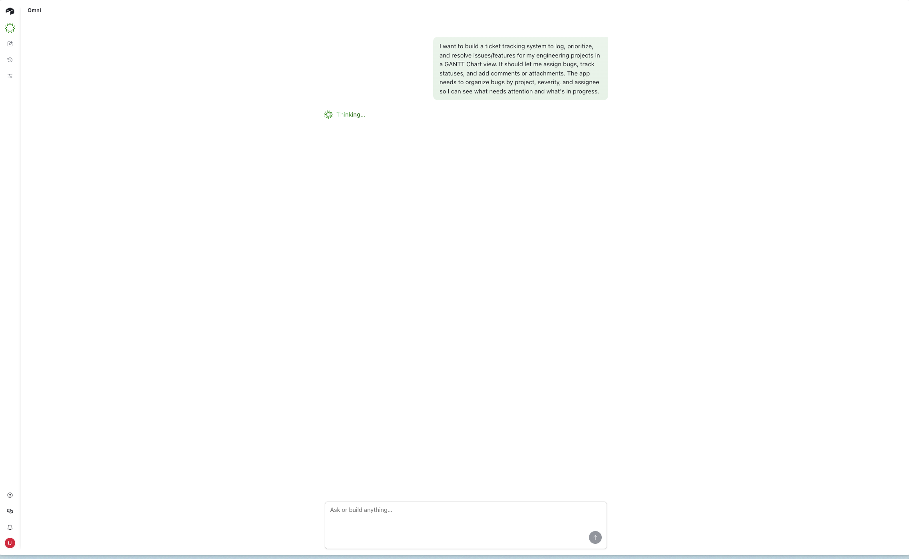

Describing the desired tracker in one sentence to Airtable's AI assistant ("Omni") shows the request echoed back with a "Thinking..." spinner while the base gets built.

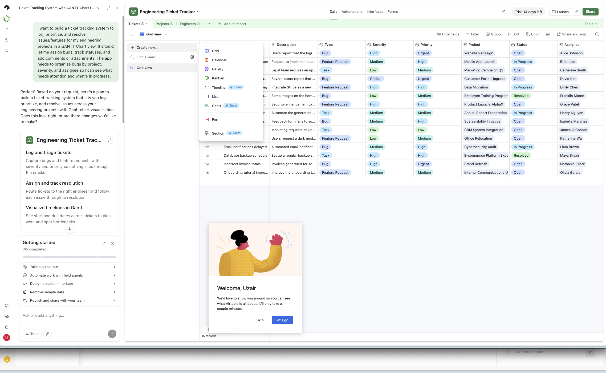

Once built, the assistant's plan appears broken into three named, one-line-each capabilities ("Log and triage tickets," "Assign and track resolution," "Visualize timelines in Gantt") alongside a "Getting started" checklist (Take a quick tour / Automate work with field agents / Design a custom interface / Remove sample data / Publish and share with your team). This same screenshot also catches the "Create new…" view menu open over the grid — Grid, Calendar, Gallery, Kanban, Timeline, List, Gantt, Form, and Section, with Timeline, Gantt, and Section each carrying a "Team" plan badge — plus a "Welcome, Uzair" product-tour modal layered on top.

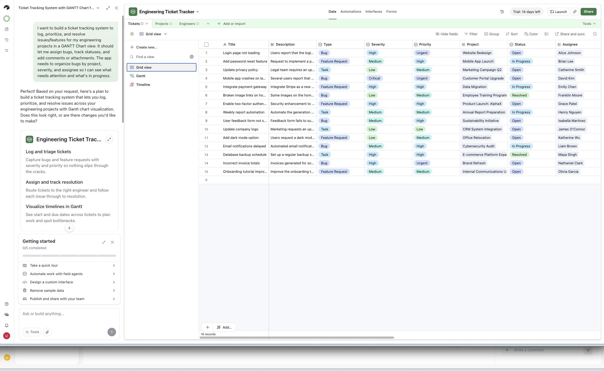

With the menu and tour dismissed, the same chat panel sits next to the finished result: a Grid view with 15 pre-populated sample tickets spanning multiple different Projects and Assignees.

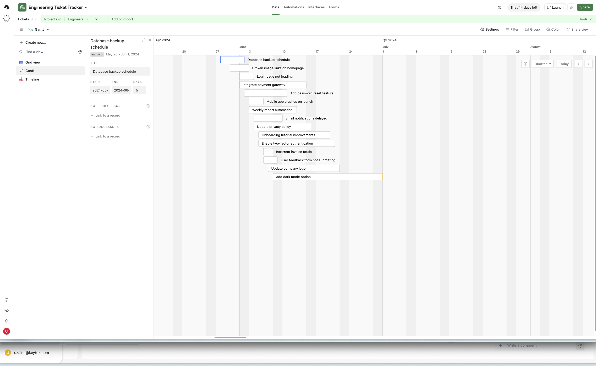

Clicking a bar on the Gantt chart opens a compact side panel (not a full-page modal) with Title, Start, End, and Days fields, then two sections labeled "NO PREDECESSORS" and "NO SUCCESSORS," each with its own "+ Link to a record" control. The labels update in place once links exist — "3 PREDECESSORS," "1 SUCCESSOR" — rather than staying as a generic "Dependencies" header.

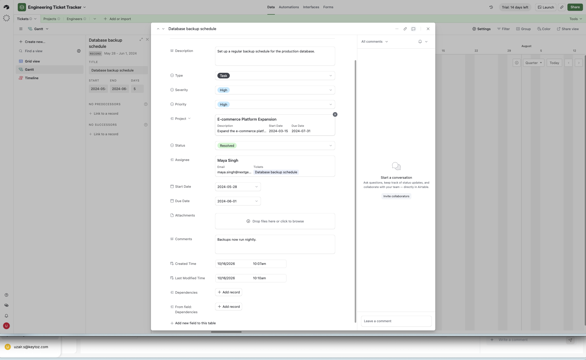

Opening the same record as a full-page modal (via expand, not the Gantt side panel) lists every field on the ticket: Description, Type (Task / Bug / Feature / Feature Request), Severity, Priority, a linked Project field (shown with the linked project's own description and dates inline, as a small preview card), Status, a linked Assignee field (same inline-preview treatment, showing the person's email and their other tickets), Start Date, Due Date, Attachments, a plain-text Comments field, Created Time and Last Modified Time (both read-only, system-tracked), and separately, a "Dependencies" field plus its reciprocal "From field: Dependencies." At this point neither has a link yet.

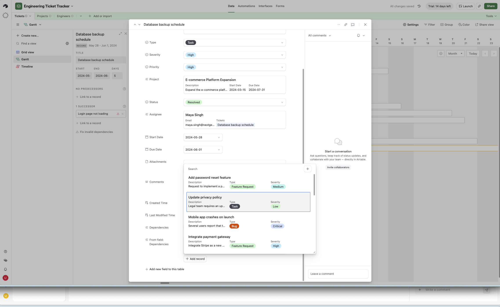

By now the side panel shows "1 SUCCESSOR: Login page not loading." Opening the Dependencies field's record picker shows the same inline-preview treatment as the Project and Assignee fields: each candidate record (Add password reset feature, Update privacy policy, Mobile app crashes on launch, Integrate payment gateway) shows its own Description, Type, and Severity right there, not just a bare name. This "Dependencies" field is an ordinary linked-record field, distinct from the Predecessors/Successors sections the Gantt side panel shows — the two don't appear to be the same underlying mechanism.

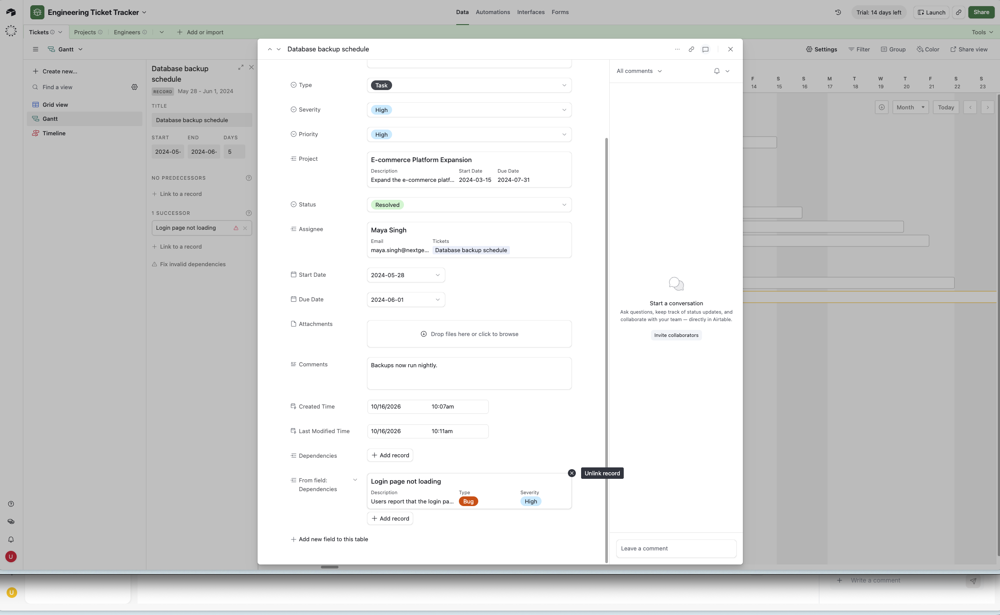

With "Login page not loading" picked, it shows up as a linked card under both "Dependencies" and "From field: Dependencies," with an "Unlink record" option on hover. The side panel's "1 SUCCESSOR" entry carries a small warning triangle next to the linked record's name, plus a "Fix invalid dependencies" link directly underneath.

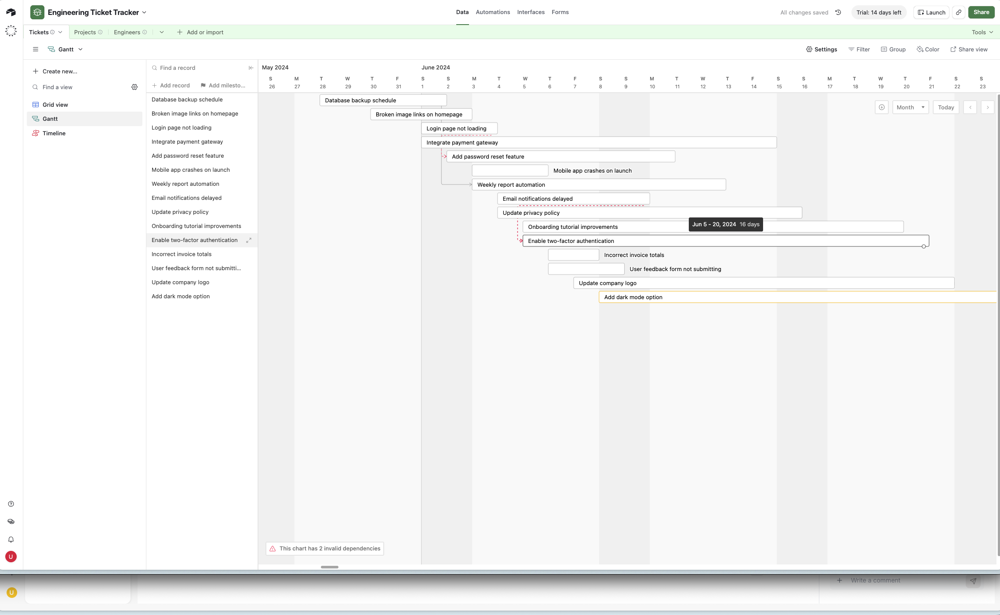

This is the key screenshot. Dependency lines are drawn as right-angled connectors with arrowheads (closer to the elbow-line style seen in Wrike's classic view than to Jira's or ClickUp's curves). The line's own style carries meaning: a plain line means two linked tasks don't overlap in time, so the dependency holds without the schedule actually clashing. A dashed red line means the linked tasks' timelines do overlap — the dependency says one should wait on the other, but the dates currently have them running at the same time, which is a real conflict, not just a relationship. A banner sits at the bottom-left of the chart reading "This chart has 2 invalid dependencies," one per dashed red line. Dragging a bar's edge shows a live tooltip with the resulting date range and day count ("Jun 5 – 20, 2024, 16 days"), same pattern as every other tool surveyed.

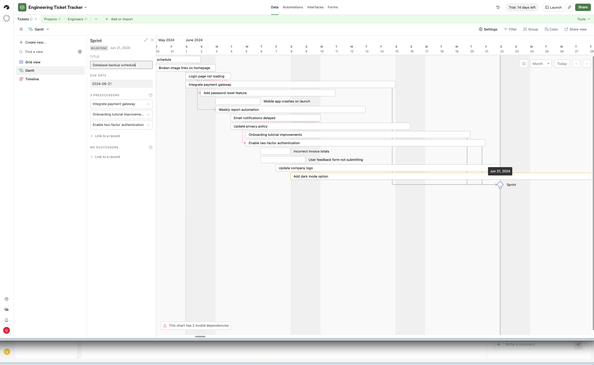

A record can be typed as a Milestone instead of a Task — shown as a badge reading "MILESTONE" instead of "RECORD" in the panel header. A milestone has a single Due Date field (no Start/End range) and renders as a diamond marker on the chart instead of a bar, but it uses the exact same Predecessors/Successors sections as a regular task. In this screenshot, a milestone named "Sprint" has 3 Predecessors listed (Integrate payment gateway, Onboarding tutorial improvements, Enable two-factor authentication) and 0 Successors — so several tasks can all feed into one milestone, and the milestone participates in the same link graph as everything else rather than being a separate kind of object.

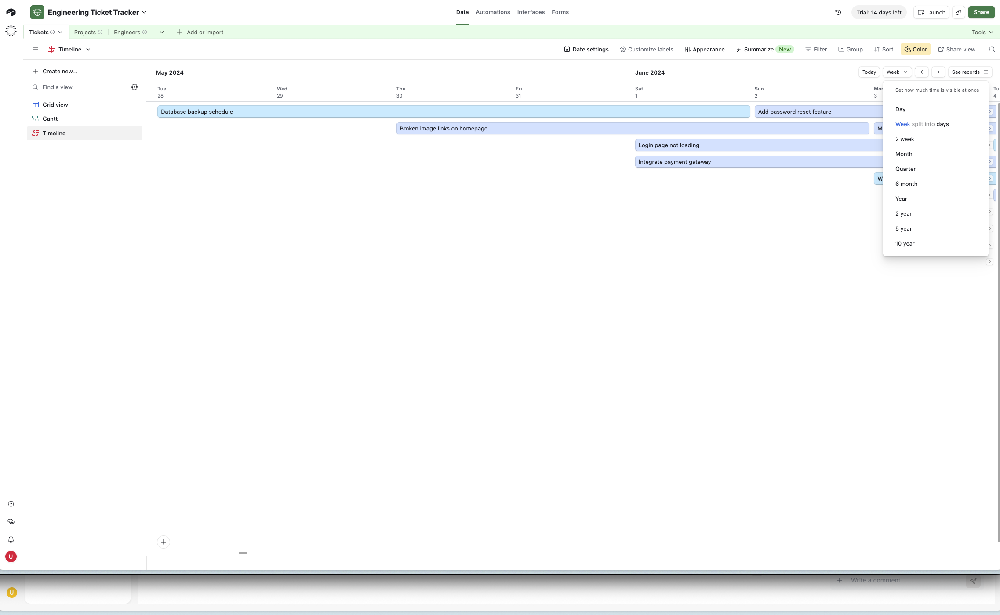

The Timeline view is a separate, third view type alongside Grid and Gantt (visible in the left sidebar as its own entry). Its zoom control is a long explicit list rather than a handful of fixed buttons: Day, Week split into days, 2 week, Month, Quarter, 6 month, Year, 2 year, 5 year, 10 year. Its toolbar also includes a "Summarize" button marked with a "New" badge, which doesn't appear on the Gantt view's toolbar.

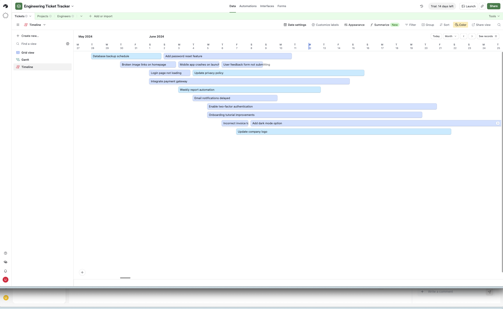

At Month zoom with no color grouping applied yet, every ticket renders as the same plain light-blue bar.

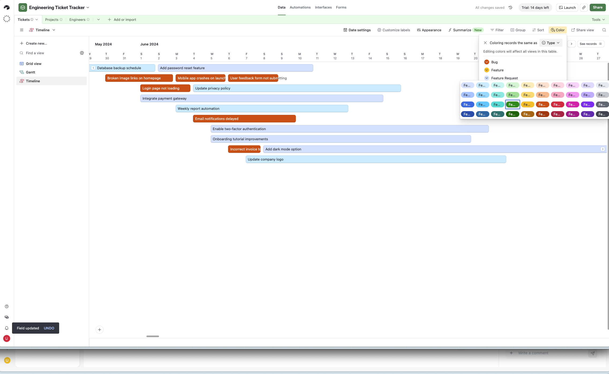
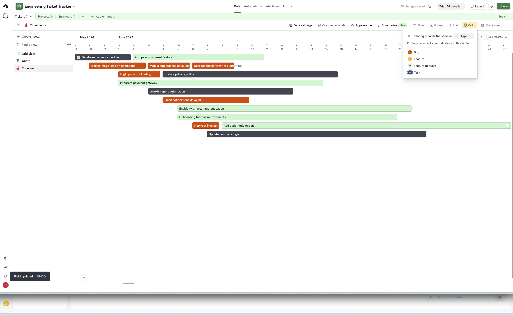

A "Color" control lets you color every bar by a field's value ("Coloring records the same as Type"). Picking the exact color for one value opens a much larger swatch grid (four rows of roughly nine colors each) rather than a small fixed palette. Once set, Bug / Feature / Feature Request / Task each get their own distinct color (orange, yellow, green, dark navy), applied consistently across both the Gantt and Timeline views at once — changing it in one updates the other.

## Sources

- [Gantt view milestones, dependencies, and critical paths](https://support.airtable.com/articles/9146034701-gantt-view-milestones-dependencies-and-critical-paths)
- [Airtable Task Management: Subtasks, Dependencies, Recurring](https://www.business-automated.com/tutorials/airtable-task-management-with-subtasks)
