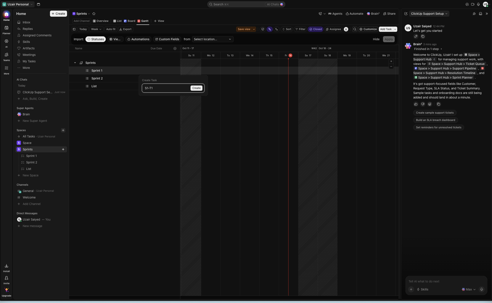
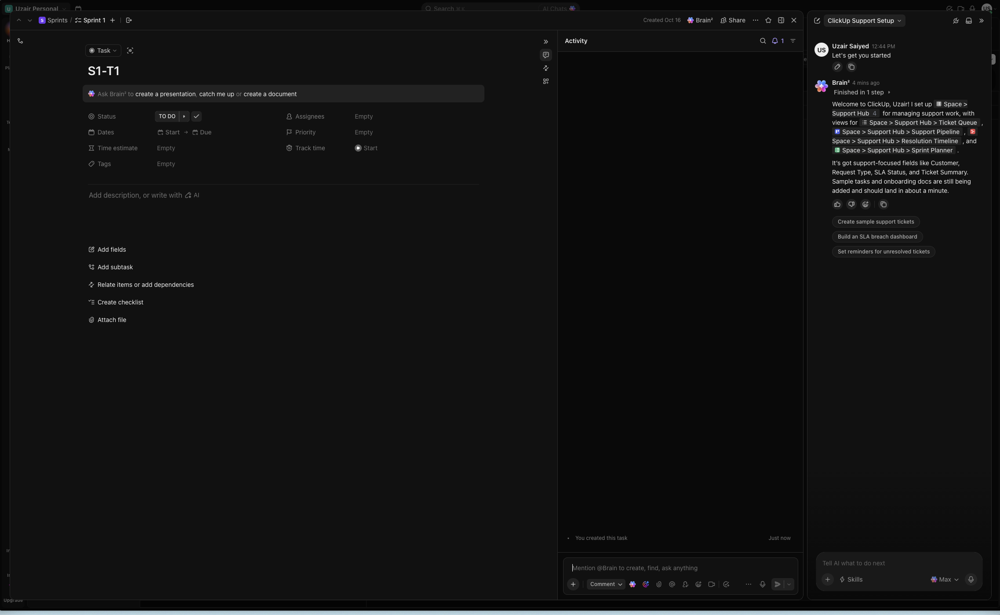
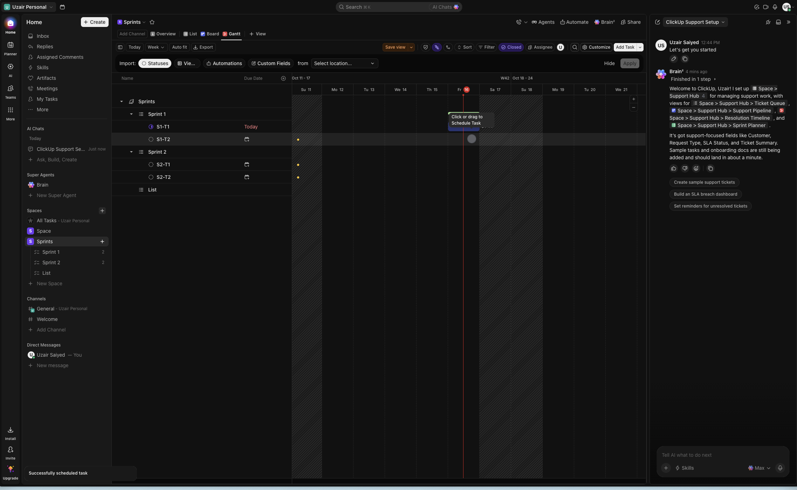
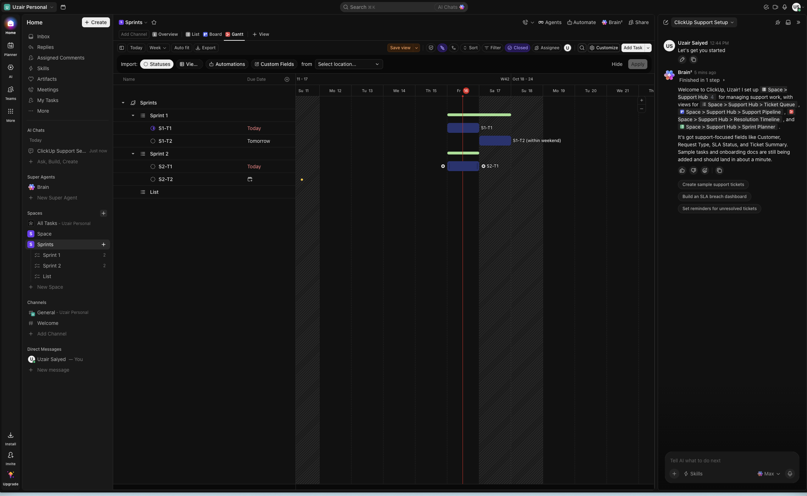
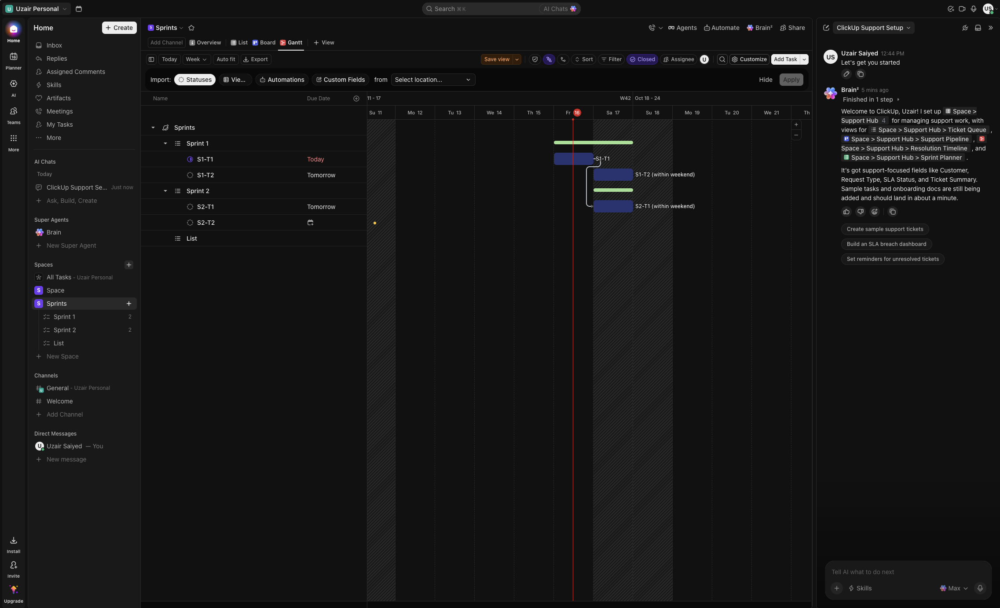
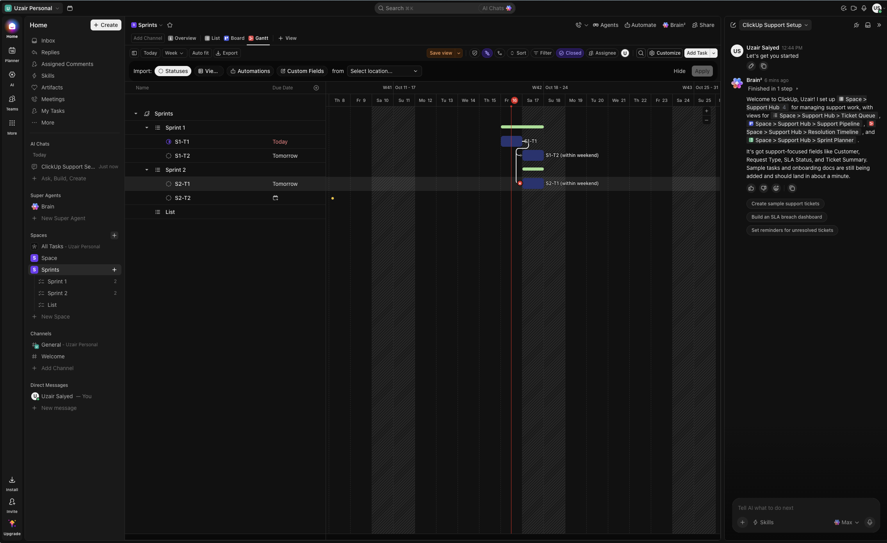
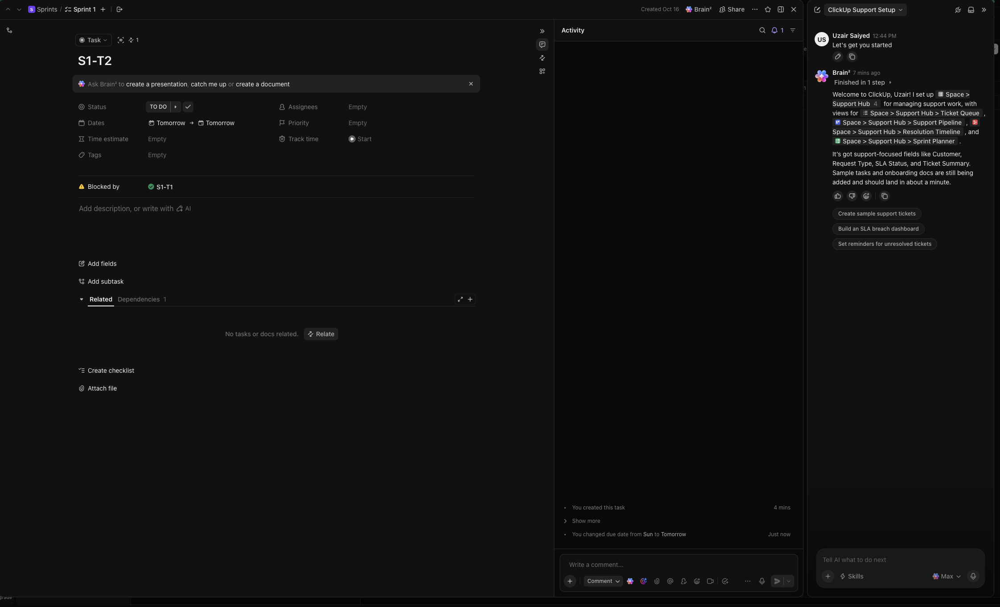
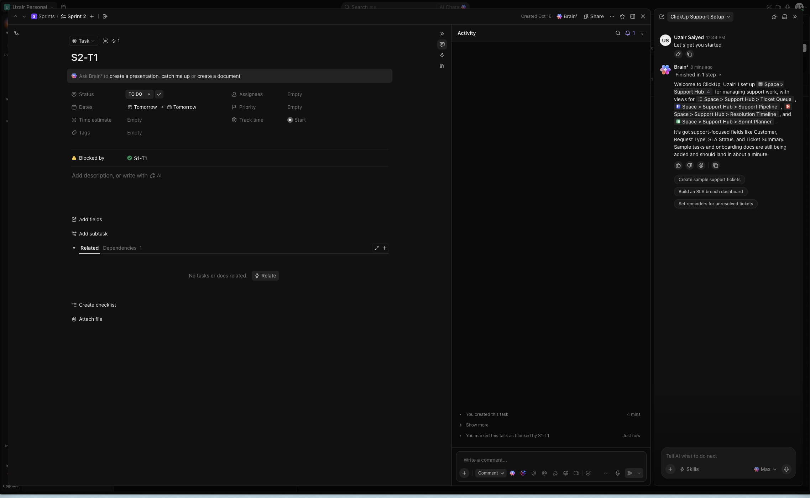
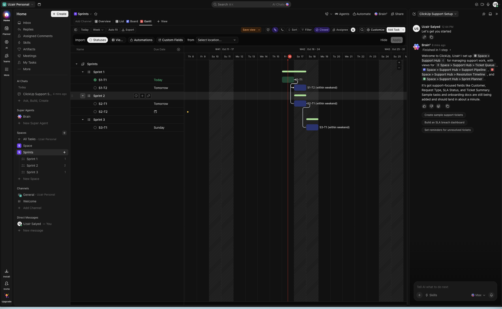
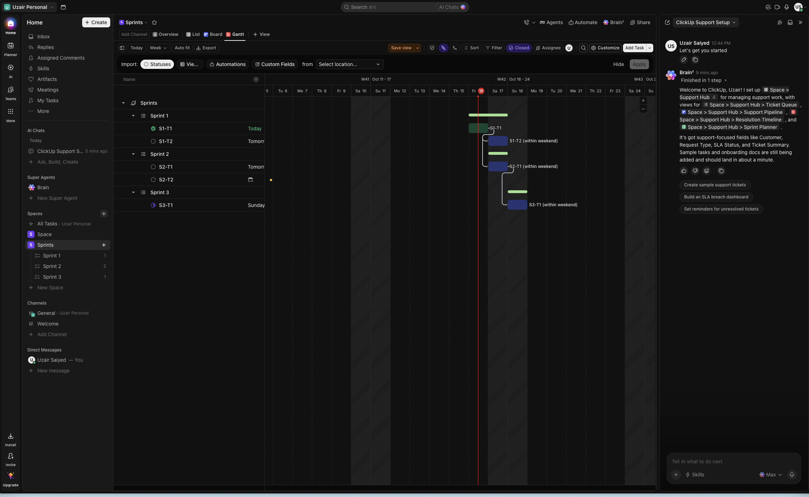

# ClickUp

Right-click a task and you get "Waiting on," "Blocking," or "Related." In Gantt view you can also drag one bar's edge onto another to set the same thing directly.

"Blocking" is worth calling out: it's a named relationship, not a generic "dependency." That's closer to the way the goal here was described — blockers, not abstract predecessor/successor pairs.

Move a task and every downstream task shifts with it, automatically (ClickUp shipped this mid-2026), skipping weekends along the way. There's also a Critical Path toggle that dims everything not on the critical path, and a separate Slack Time view showing how much buffer a non-critical task has before it starts to matter. That slack number is basically an answer to "how far can this drift before it becomes urgent" — one of the things named as a goal here.

**Verification status:** the named "Blocked by" relationship, the auto-cascade, and the weekend-skip behavior are all confirmed firsthand below — the cascade was caught live, not just claimed. Critical Path toggle and Slack Time were not opened in this walkthrough; still secondhand.

**Citation fix (2026-10-16):** every image in this section was re-opened and checked against its caption after an independent review found several pointed at the wrong file — in this set, several gantt-view screenshots and task-detail-panel screenshots were swapped with each other, and the real row-hover/full-chain screenshot had been filed under "create-task popover." All citations below are now re-matched to what the file actually shows.

## Live walkthrough (screenshots, 2026-10-16)

Screenshots of a real ClickUp workspace, Gantt view on a "Sprints" list built up step by step. Files live in `../assets/clickup-gantt-walkthrough/`.

Starting point: an almost-empty board with just "Sprint 1" and "Sprint 2" created, no tasks yet. Clicking into the empty grid opens a small floating "Create Task" box right where you clicked — type a name (`S1-T1` here), hit Create, done. No need to leave the chart or open a side panel first.

Opening that new task shows every field empty — no assignee, no dates, no dependency — with "Relate items or add dependencies" sitting as an unused menu link. This is the task before any blocker gets added.

Once dates and a blocker are set, the Gantt view shows S1-T2 and S2-T1 already carrying a "(within weekend)" label — ClickUp flagging on its own that the auto-cascade pushed those tasks' dates onto a Saturday or Sunday. Nobody asked for that label. ClickUp decided it was worth a flag, which is itself a small, unprompted example of what "smart" scheduling feedback could look like — not a conflict exactly, but a heads-up that something about the schedule needs a second look.

Opening S1-T2's task detail shows a dedicated field right under Status and Dates, labeled "Blocked by," with a small warning triangle and S1-T1 as a clickable chip (shown here already complete, with a green check). It isn't buried in a side panel the way Jira's version is — it sits in the main body of the task, impossible to miss.

Opening S2-T1's task detail shows the same "Blocked by: S1-T1" field, and the task's own activity log picks it up immediately: "You marked this task as blocked by S1-T1 — Just now." So the relationship isn't silent — setting it gets written into the task's own history, in plain words, not just reflected on the chart.

With S1-T1 marked complete (dark green bar, checkmark status), S1-T2 and S2-T1 show up connected to it by curved lines across the Sprint 1 / Sprint 2 boundary — the chain reacts to real progress, not just to date edits, and it already crosses a sprint boundary here, before Sprint 3 even exists.

Tasks with no dates yet show up as a small dot in the Due Date column and nothing on the chart. Hover over the grid at any point in that row and a tooltip offers "Click or drag to Schedule Task" — clicking drops a bar right there, confirmed with a small "Successfully scheduled task" toast in the corner.

This is the most useful screenshot of the whole batch. Once Sprint 3 and S3-T1 exist, the chain extends to S1-T1 (done) → S1-T2 → S2-T1 → S3-T1, all four bars connected by curved lines on one chart, spanning Sprint 1, Sprint 2, and Sprint 3 at once. That's a real answer to "flow across sprints" — not three separate sprint views stitched together after the fact, one timeline with the whole chain visible on it. The same screenshot also catches Sprint 2's row mid-hover, showing a jump-to icon, a `+`, and an edit pencil appear next to the sprint name — the same hover pattern seen in Jira.

The same four-task chain, confirmed to persist after scrolling and rezooming the chart — the lines aren't a one-time render artifact tied to a specific view state.

Two other screenshots from this batch (`04`, `10` in the assets folder) show intermediate states of the same cascade at different points in the walkthrough — included for completeness, not reproduced individually since they don't add new behavior beyond what's shown above.

## Sources

- [ClickUp Gantt Chart View](https://clickup.com/features/gantt-chart-view)
- [Critical Path Method (CPM) in Project Management](https://clickup.com/blog/critical-path/)
- [How to Use ClickUp's Gantt Chart in 2026 (Auto-Scheduling)](https://www.zenpilot.com/blog/how-to-best-leverage-clickups-gantt-chart)
