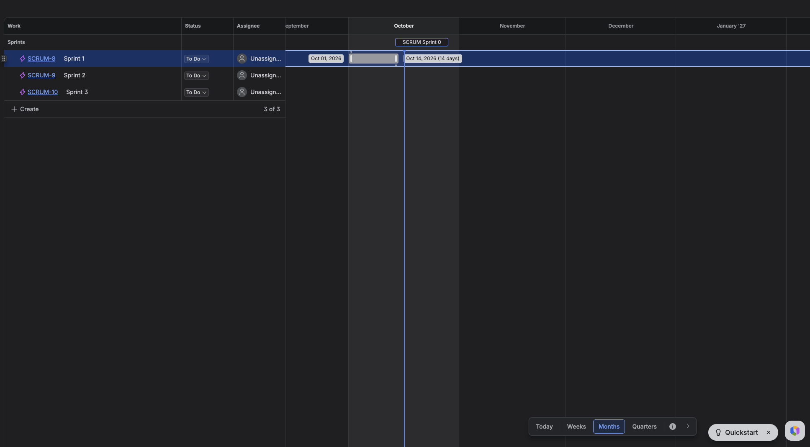
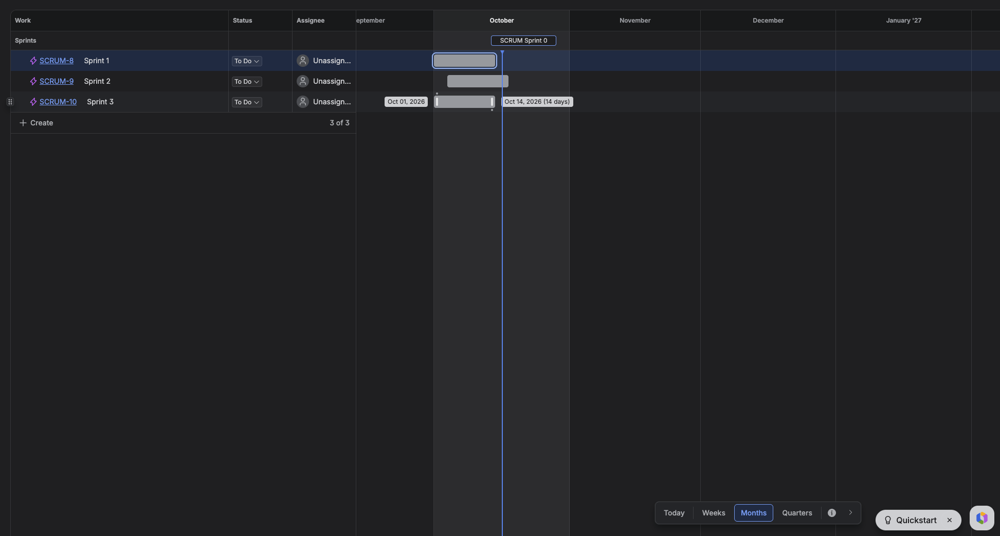
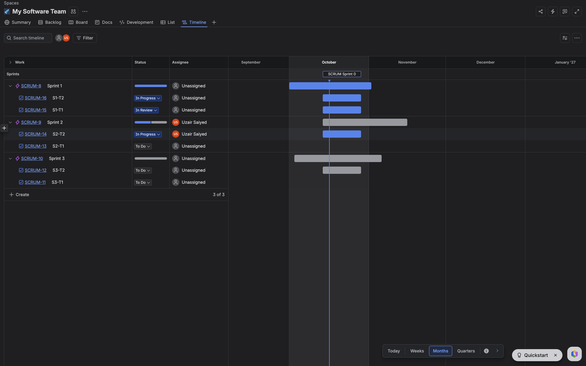
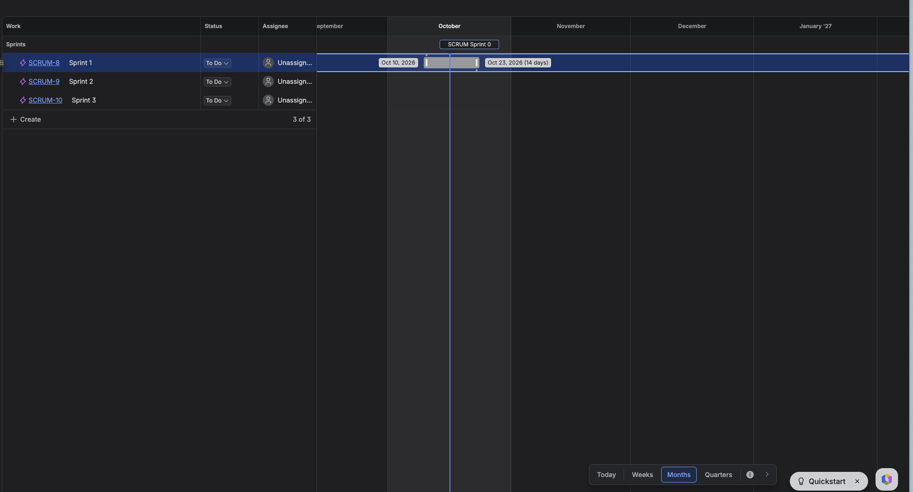
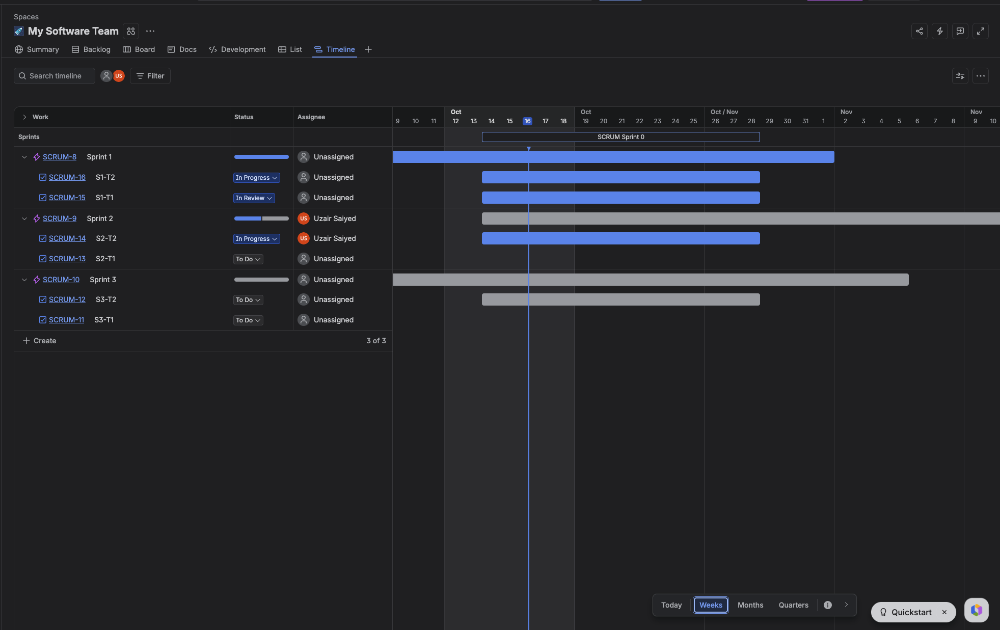
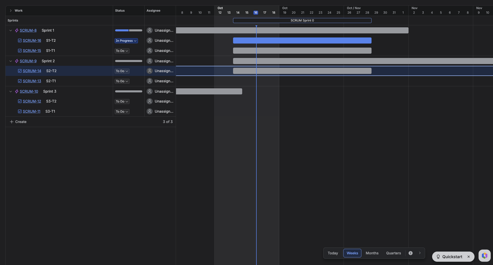
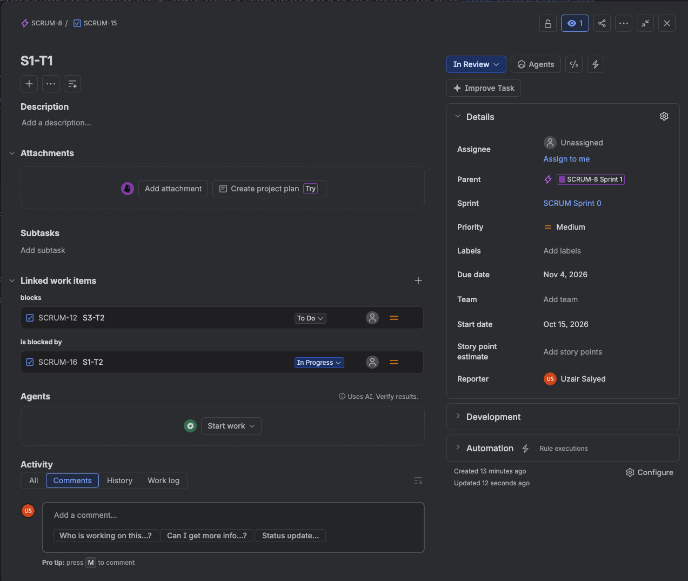
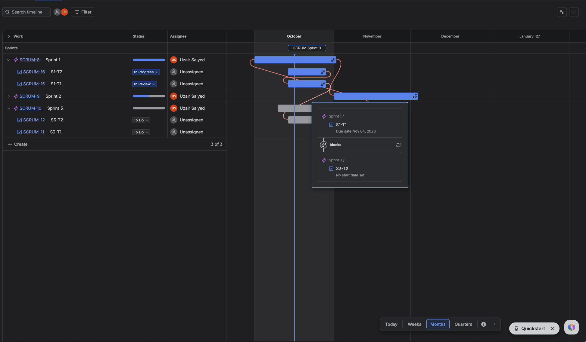
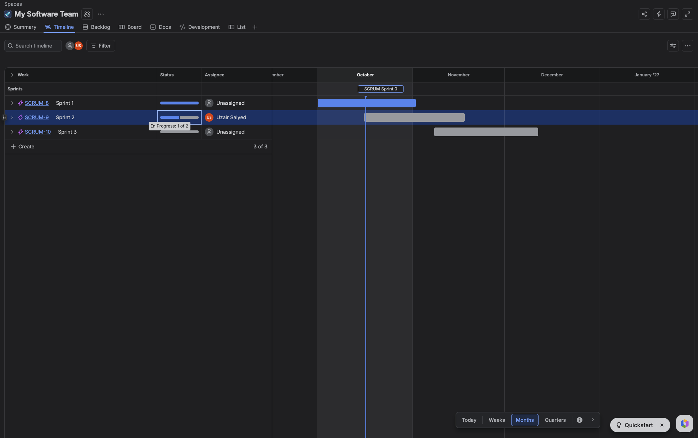
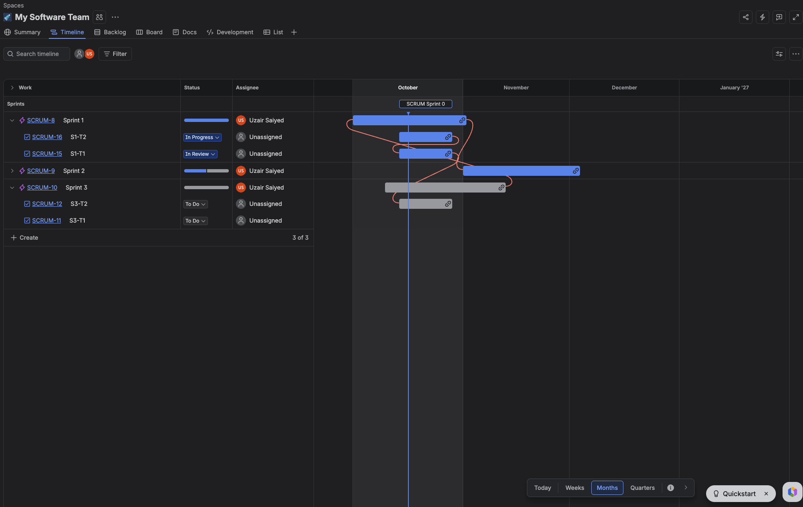

# Jira — Timeline / Advanced Roadmaps

## How it works, from write-ups

You drag the handle at the end of a bar onto another bar, and that creates a "blocks" link, drawn as a line on the chart. You can set the same link from the issue's "linked issues" panel instead, if dragging isn't your thing.

Only finish-to-start actually renders as a line on the native Timeline. If you've set up other link types in the data, Jira still draws them as if they were sequential — it doesn't distinguish. A red dependency line means the linked dates don't agree with each other. That's all it means. Jira shows you the problem and leaves the fix to you.

The other three dependency types, full auto-scheduling, and critical path are locked behind Advanced Roadmaps (the Premium plan). And a dependency pointing to a task in a different project may not even show up if you're looking at a single-project timeline — the line just isn't there.

**Verification status:** the "blocks" link creation and the plain-language "blocks" / "is blocked by" split are confirmed firsthand below. The claims about only finish-to-start rendering, red lines meaning a date clash, and the Advanced Roadmaps paywall were not tested — no other link type, no conflicting dates, and no Premium plan were tried in this workspace. Treat those three as still secondhand until someone checks them directly.

**Citation fix (2026-10-16):** every image in this section was re-opened and checked against its caption after an independent review found several pointed at the wrong file. All citations below are now re-matched to what the file actually shows; nothing in the prose changed, only which filename backs which claim.

## Live walkthrough, no dependencies set (screenshots, 2026-10-16)

Screenshots of a real Jira "Timeline" tab (a Scrum-template project called `SCRUM`), not secondhand write-ups. Files live in `../assets/jira-timeline-walkthrough/`.

A sprint is a real row with its own bar, not a label. `SCRUM-8 Sprint 1`, `SCRUM-9 Sprint 2`, `SCRUM-10 Sprint 3` each sit at the top level, spanning the sprint's actual date range. Expand one and its child issues (`S1-T1`, `S1-T2`, ...) appear underneath, indented, each with its own bar — and the parent bar's length is just the outer edge of its children's bars. Nesting on the same chart is real here, not a trick of grouping by color. A milestone shows up as a labeled flag sitting in its own lane above the rows (`SCRUM Sprint 0`), visible in both screenshots above. A thin vertical line marks today, running the full height of the chart.

The sprint row's "Status" column isn't a status at all — it's a small segmented bar, blue for done/in-progress, gray for the rest, and hovering it tells you something like "In Progress: 1 of 2." A rollup, computed from the children, sitting next to each child's own actual status dropdown. Nothing new was invented to make this work; it's just read off the existing child statuses.

Dragging the edge of a bar to resize it pops up live date tooltips on both ends while you drag (`Oct 10, 2026` ... `Oct 23, 2026 (14 days)`) — the duration updates as you move, not just after you let go.

Hovering a row reveals a `+` and a `...` next to the sprint name, plus a "More actions" tooltip on the `...` — quick ways to add work without leaving the timeline.

Zoom is four fixed buttons (Today / Weeks / Months / Quarters), not a slider, and switching between them changes both the header's date granularity and how wide each bar renders — this screenshot is the same expanded sprint structure as above, re-rendered at Weeks zoom with day-level columns. Assignee sits in its own column with an avatar; it doesn't touch the bar itself. None of the sprints or tasks in this batch of screenshots have dependencies set, which is exactly why the next section matters.

Other screenshots from this same batch (`04`–`07`, `09`, `13` in the assets folder) show the same mechanics at different zoom levels and hover states — included for completeness, not reproduced individually here since they don't add new behavior.

## Live walkthrough, with dependencies set (screenshots, 2026-10-16)

Once a couple of tasks actually have a "blocks" link between them, curved orange-red lines connect their bars directly — not just a straight arrow, but a line that routes around other bars to reach its target. Each bar also grows a small chain-link icon at its edge once it's involved in a dependency, which doubles as the drag handle for creating a new one.

Hovering a dependency line pops up a small card naming both ends plainly: "Sprint 1 / S1-T1, due Nov 04, 2026" on one side, "blocks," then "Sprint 3 / S3-T2, no start date set" on the other. No chart-reading required — it just tells you, in words, what's connected to what and why.

Opening a task's own detail panel shows the same relationship from the inside, under a "Linked work items" heading split into two labeled groups: "blocks" (what this task is holding up) and "is blocked by" (what's holding this task up), each listing the linked task with its own status pill inline. This is the clearest piece of prior art in the whole research pass for what was described as the goal — a task that says, in plain terms, what it's blocking and what's blocking it, not just a line on a chart you have to interpret.

One more variant of the board view, with Sprint 1 and Sprint 3 expanded and Sprint 2 collapsed, at Months zoom: the dependency lines route from a child task, through a collapsed sprint's own bar, and on to another child task further down the board — confirming the lines don't break just because the chart in between them is collapsed.

## Jira Plans (Advanced Roadmaps) — parent dates and overrun warnings (added 2026-10-21, documentation only)

Two claims below, sourced from Atlassian's own documentation and a community forum post — not verified against a running Jira Plans instance, and not screenshot-backed the way the walkthrough above is.

Per Atlassian's own documentation: a parent issue (epic) on the roadmap can either have its dates set manually, or have them inferred automatically from its child issues' dates — and sprints render directly in the timeline header, not as a separate container a child issue must belong to. Source: [Manage epics on the roadmap (Atlassian documentation)](https://confluence.atlassian.com/jirasoftwarecloud/manage-epics-on-the-roadmap-976172306.html).

Per a community forum answer — **lower-quality source, a user's forum post, not Atlassian's own documentation, flagged as such rather than treated as confirmed** — Jira Plans shows a warning when a child issue's dates run past its parent epic's due date, but does not relocate or constrain the child automatically; it surfaces the conflict and leaves the resolution to the user. Source: [Plan Epics in Parallel in Jira Plans (Atlassian Community forum)](https://community.atlassian.com/forums/Advanced-Planning-in-Jira/Plan-Epics-in-Parallel-in-Jira-Plans/td-p/2882771).

Relevant to this repo's own v2 round: this is the closest precedent found, across every tool in this folder, for "a task running longer than its container" — and it only gets as far as inferring dates and warning on overrun, not actually letting a child's bar render as a single continuous bar crossing a sprint-band boundary the way `docs/gantt-chart/spec/v2/spec.md` proposes. None of the tools surveyed in this repo's research do more than Jira Plans does here — see `01-feature-plan.md`'s updated note on this same gap.

## Sources

- [What is a Gantt chart? (Atlassian)](https://www.atlassian.com/agile/project-management/gantt-chart)
- [How to Track Dependencies in Jira](https://getsimplegantt.com/blog/track-dependencies-jira/)
- [Jira Gantt Chart Review: Timeline vs Advanced Roadmaps](https://clickup.com/learn/topic/project-management/tools/jira/gantt-charts/)
