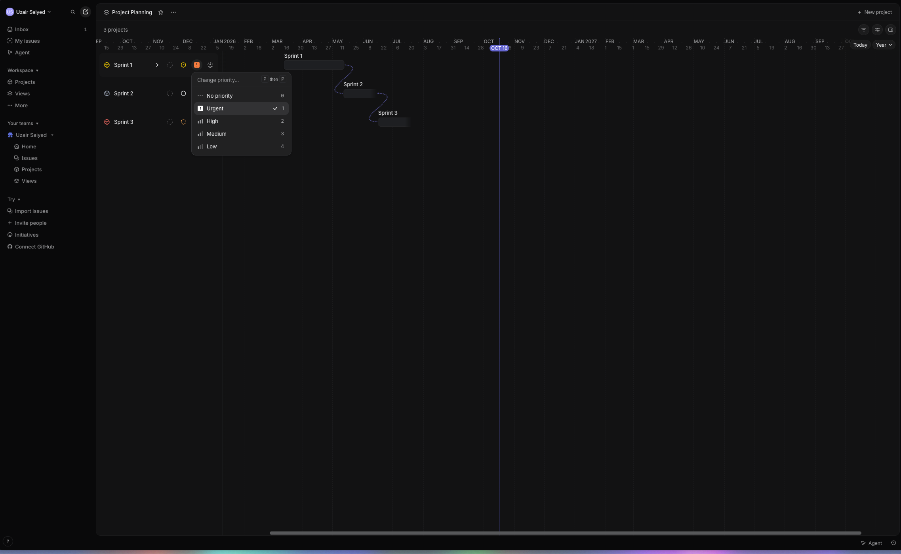
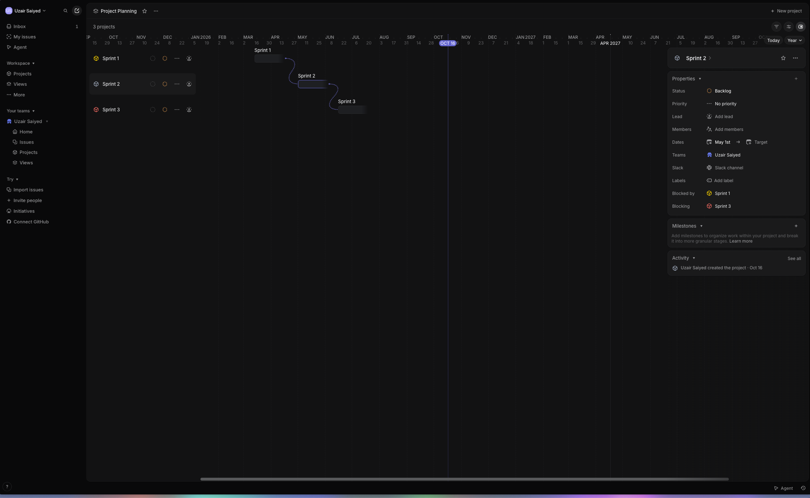
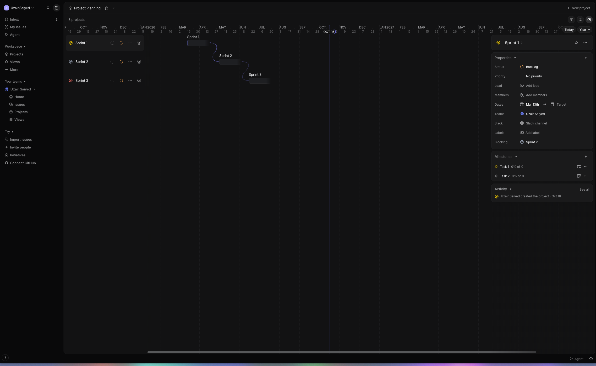
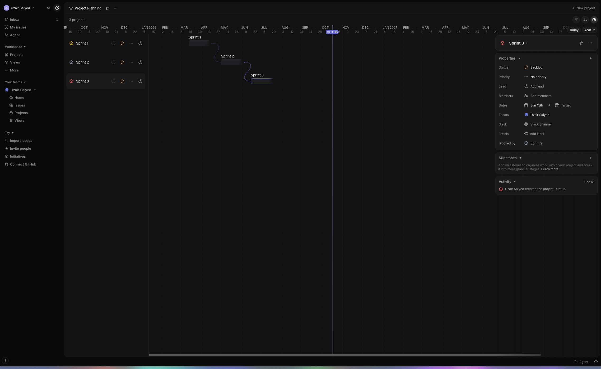

# Linear — the closest thing to prior art for "sprint"

Linear's sprint equivalent is called a Cycle: a fixed, time-boxed period (two weeks by default) with incomplete issues rolling over automatically into the next one.

Dependencies exist at the issue level — blocking, blocked by, related — same words ClickUp uses.

**Correction (2026-10-16):** the line below used to say Linear's roadmap view deliberately does not draw dependency lines between projects, based on secondhand write-ups. A live walkthrough (see below) shows the opposite — project-to-project dependencies render directly on the timeline, with named fields in the project's own panel. Leaving the secondhand claim struck through rather than deleting it, since it's a useful reminder that write-ups about a tool's feature set can be wrong or stale, and firsthand screenshots should win when they conflict with research.

~~The roadmap view deliberately does not draw dependency lines between projects, and has no critical path. That's not a missing feature, it's a stated design choice: Linear treats the roadmap as "here's when things ship" for stakeholders, and cycles as "here's this week's work" for the team, and refuses to mix the two.~~

## Live walkthrough (screenshots, 2026-10-16)

Screenshots of a real Linear workspace, a "Project Planning" timeline with three projects named Sprint 1, Sprint 2, Sprint 3. Files live in `../assets/linear-timeline-walkthrough/`. Worth noting up front: finding this view took several minutes of looking around the product before landing on it — it isn't surfaced as obviously as the Gantt/Timeline tabs in the other tools surveyed.

**Citation fix (2026-10-16):** files `01` and `04` had their captions swapped in an earlier pass (`02` and `03` were already correct). Fixed below.

The left pane lists each project as a row with a compact set of icon indicators next to its name — a status icon, a small ring, a priority icon (shown here as an orange "!" for Urgent on Sprint 1, opened into a "Change priority…" menu with No priority / Urgent / High / Medium / Low), and a member/assignee icon — all visible without opening the project. On the right, the same three projects render as short bars on a year-zoomed timeline, connected to each other by curved, dotted lines, labeled with the project name above each bar. A vertical line marks today.

Clicking a project bar opens a side panel with a Properties section: Status, Priority, Lead, Members, Dates (a Start → Target range), Teams, a Slack channel link, Labels, and then two separate fields named exactly **Blocked by** and **Blocking** — Sprint 2's panel lists "Blocked by: Sprint 1" and "Blocking: Sprint 3" as plain linked-project chips, not just a line on the chart. Below Properties sits a separate Milestones section ("Add milestones to organize work within your project and break it into more granular stages").

Sprint 1's panel shows only "Blocking: Sprint 2" (nothing blocks it), and its Milestones section has two entries, "Task 1" and "Task 2," each showing "0% of 0" — a milestone here is a sub-stage inside a project with its own completion percentage, distinct from the project-level Blocked by/Blocking relationship. Sprint 3's panel shows only "Blocked by: Sprint 2" (it blocks nothing further) and an empty Milestones section.

So project-to-project dependencies, drawn connector lines on the timeline, and milestones-as-sub-stages are all real, current features in Linear's timeline view — they just sit a few clicks deeper than the Gantt/Timeline tabs in Jira, ClickUp, Wrike, Smartsheet, or Airtable, which is likely why the earlier secondhand sources described the view as simpler than it actually is.

## Sources

- [Linear Roadmap: The Complete Guide for 2026](https://blog.feedvote.app/linear-roadmap/)
- [Linear vs Jira: A 2026 Guide](https://everhour.com/blog/linear-vs-jira/)
