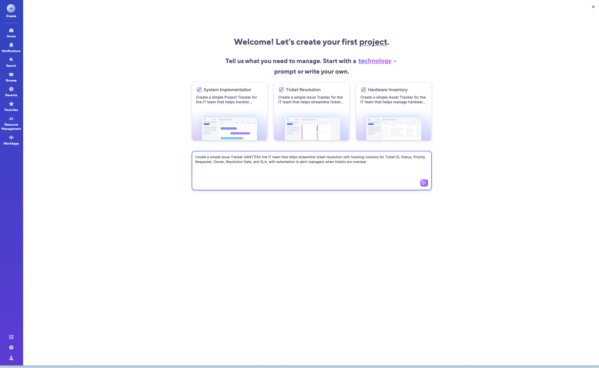
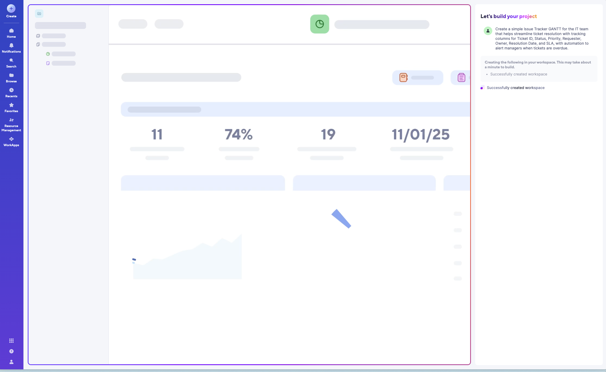
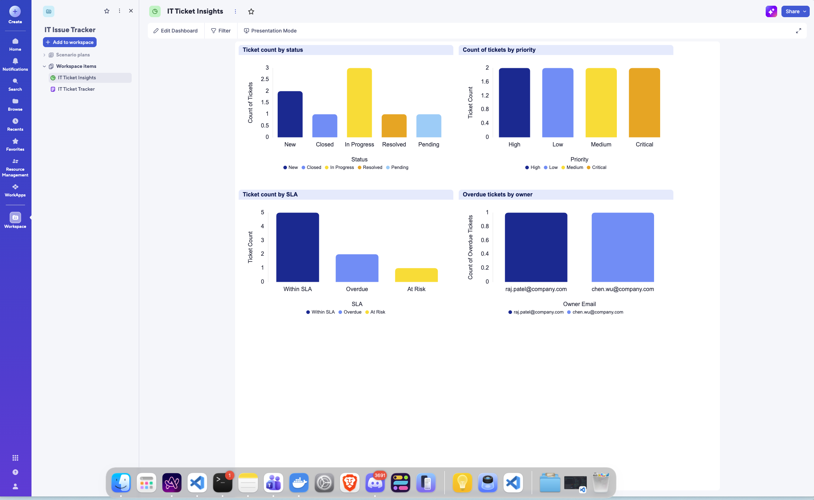
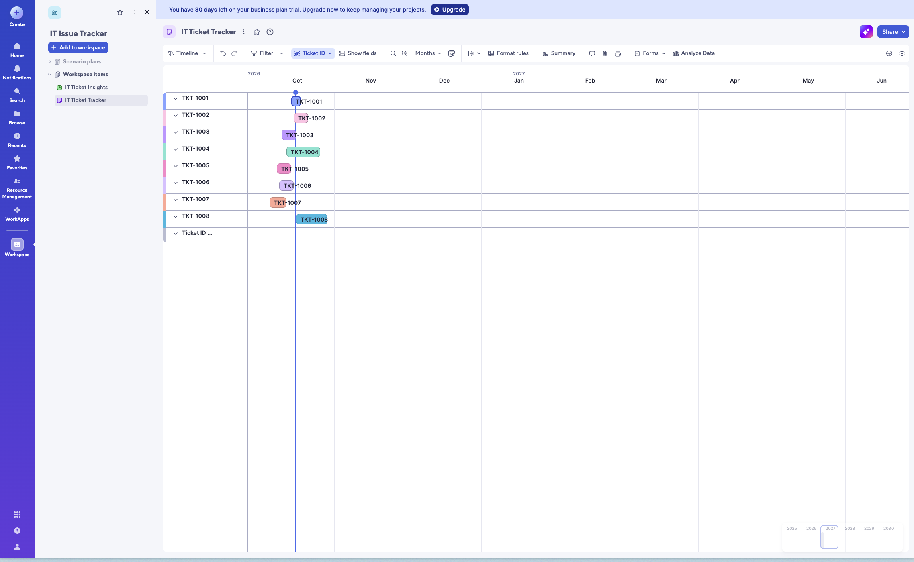
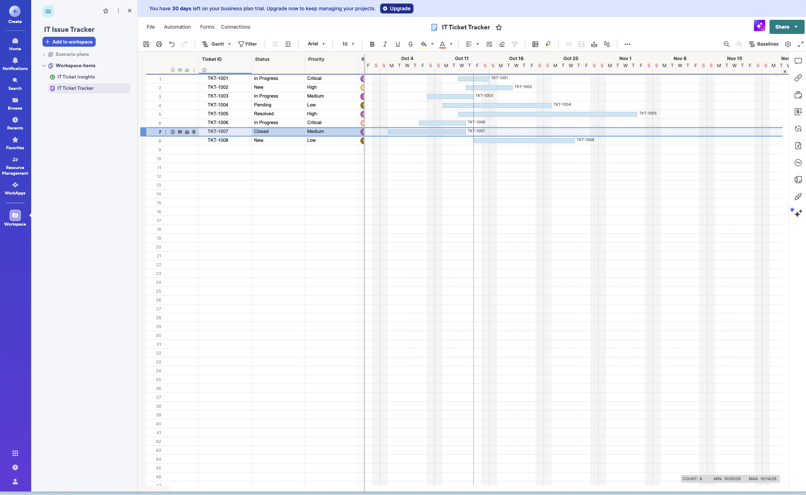
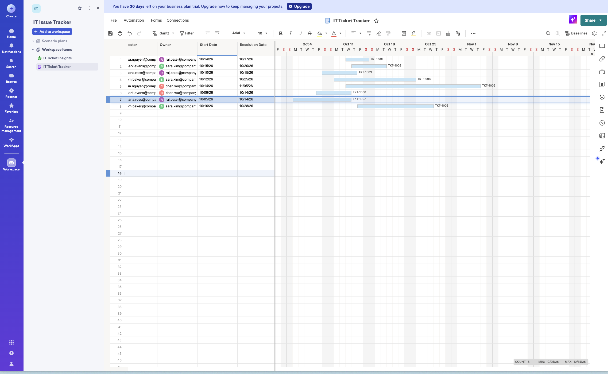
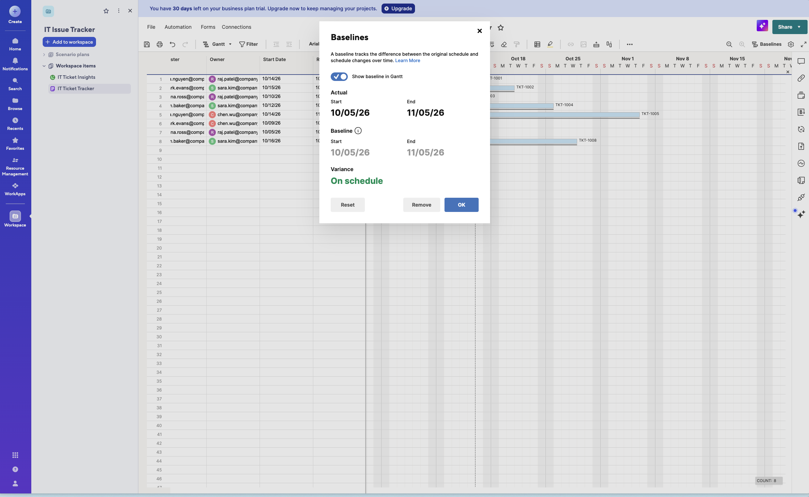

# Smartsheet

Dependencies here are set through a predecessor column — you type something like `3FS+2d` into a cell instead of dragging a line. Spreadsheet people can type relationships instead of pointing and dragging, which says something about who Smartsheet is built for.

It also has three separate path views, not just the one critical path everyone else has: critical path (the whole project's longest chain), summary path (which subtasks are driving a parent row's completion date), and driving path (which specific predecessor is setting a given task's start date). That last one is a precise answer to "why is this task scheduled the way it is" — a sharper, more useful version of "why is this blocked."

**Verification status:** none of the above (the `3FS+2d` predecessor-column syntax, or the three path views) was tested in the walkthrough below — the example base built there never had dependencies configured at all, so there was nothing to check it against. The Baseline/Variance feature, the second Timeline view, and the AI creation flow are all confirmed firsthand. Treat the predecessor-column and path-view claims as still secondhand.

**Citation check (2026-10-16):** every image in this section was re-opened and checked against its caption as part of a wider re-verification pass. All 7 are correct — no mismatches found in this set.

## Live walkthrough (screenshots, 2026-10-16)

Built by prompting Smartsheet's AI project creator with one sentence and looking at what it produced: a sheet, a dashboard, and two different timeline-style views on the same data. Files live in `../assets/smartsheet-gantt-walkthrough/`.

The creation flow opens with "Tell us what you need to manage," a category picker (it defaulted to "technology"), and three example prompts shown as cards — System Implementation, Ticket Resolution, Hardware Inventory — each with a small preview thumbnail. The three thumbnails don't look alike: one shows a glimpse of bars (Gantt-style), one shows colored vertical columns (board-style), one shows a plain list. That suggests the category examples are tied to different default view types, not just different column sets.

Typing one sentence — "Create a simple Issue Tracker GANTT for the IT team that helps streamline ticket resolution with tracking columns for Ticket ID, Status, Priority, Requester, Owner, Resolution Date, and SLA, with automation to alert managers when tickets are overdue" — was enough to generate a sheet with those exact columns, a companion dashboard, and (per the prompt) an overdue-ticket automation. The build step shows its own running log in a chat-style panel ("Creating the following in your workspace... Successfully created workspace") — a visible, step-by-step record of what the AI did, at the workspace level rather than the task level. Worth filing next to the earlier research on 2026 AI-native Gantt tools: this is the "describe it, get a working sheet" end of that spectrum, not the "AI reschedules your plan" end.

The dashboard it built has four charts off the same underlying data: ticket count by status (New / Closed / In Progress / Resolved / Pending), count by priority (High / Low / Medium / Critical), count by SLA state (Within SLA / Overdue / At Risk), and overdue tickets grouped by owner. This lives as its own separate surface, with its own toolbar (Edit Dashboard / Filter / Presentation Mode), not inside the Gantt view itself. The owner colors in this dashboard's "Overdue tickets by owner" chart match the same person-colors used for the Owner column avatars in the sheet (raj.patel always the same color, sara.kim always another, chen.wu another) — the color coding for a given person stays consistent across both surfaces.

There's a second, much lighter view called "Timeline" sitting next to the full Gantt grid — Wrike also ships two different Gantt UIs, so this isn't unique to Smartsheet. Its toolbar is different from the Gantt grid's: a grouping dropdown (currently grouped by Ticket ID), Show fields, a zoom control, a Months granularity dropdown, and an "Analyze Data" button that isn't present on the main Gantt grid at all. Each ticket renders as a short colored pill rather than a full-width bar — at Months zoom, all eight tickets' pills land inside October, leaving November through the following June empty on screen, so the chart doesn't appear to auto-fit its zoom to the data it's showing.

The main Gantt grid is a flat list of eight tickets, one row each — no grouping, no sprints, no subtasks, no expand/collapse row controls anywhere in this build. Underneath the chart, a footer bar reads "COUNT: 8  MIN: 10/05/26  MAX: 10/14/26" — a running aggregate of row count and date range, computed automatically. A vertical rail of icons sits on the right edge of the grid view specifically (comment, attachment, approval, automation, compare, publish, formatting, link, and an AI sparkle at the bottom) — this rail is present on the Gantt grid but not on the Timeline-lite view or the dashboard, each of which has its own, different toolbar instead.

Baselines capture a task's original planned Start/End as a snapshot, then track the live Actual dates against that snapshot, surfacing a plain-language verdict ("On schedule," shown in green) rather than leaving you to compare two date columns by eye. The dialog also has Reset and Remove buttons, so a baseline is a deliberate, manually-managed snapshot rather than something continuously recalculated. A "Show baseline in Gantt" toggle overlays a thin reference bar under the live bar on the chart itself, on by default in this screenshot.

## Sources

- [Activate dependencies and use predecessors in grid and Gantt view](https://help.smartsheet.com/articles/765727-enabling-dependencies-using-predecessors)
- [Critical, Summary, and Driving Paths](https://help.smartsheet.com/learning-track/level-3-solutions/critical-summary-and-driving-paths)
