# Wrike — the closest thing to prior art for "blocker" visualization

Wrike's dependency lines are plain connectors most of the time, but there's a feature called Conflict Monitor that turns an arrow red the moment the linked dates stop agreeing with each other — for example, when a predecessor finishes after the milestone it's supposed to feed. It's a live, re-checked state, not a one-time validation.

There's also a bottleneck pattern worth noticing: one task with several arrows fanning out to parallel downstream tasks. You can see at a glance that one approval is holding up three separate workstreams, without reading a single task name.

One thing Wrike doesn't do, and its own users have asked for: click a task and see its *entire* dependency chain light up, not just the one link next to it. Every tool surveyed so far only highlights the immediate neighbor. Nobody shows the full chain. That's a real, confirmed gap — not a guess.

**Verification status:** the Predecessors/Successors panel, the shorthand predecessor column, the ask-before-cascading prompt, and the cross-sprint ripple are all confirmed firsthand below. The Conflict Monitor red-arrow behavior was not triggered in this walkthrough (noted explicitly where it comes up) — still secondhand. The "nobody shows the full chain" gap is sourced from Wrike's own public community forum, not a blog write-up, so it's a step more reliable than typical secondhand research, but it's still not something tested directly here.

**Citation fix (2026-10-16):** every image in this section was re-opened and checked against its caption after an independent review found several pointed at the wrong file. In this set, the two setup screenshots were swapped with each other, the row-hover screenshot and two of the three cascade-prompt moments were filed under the wrong names, and the real Predecessors/Successors task panel had been cited as a different file entirely. All citations below are now re-matched to what the file actually shows.

## Two Gantt views, not one

Wrike actually ships two different Gantt UIs, and you can jump between them (a button in the toolbar reads "Try new Gantt Chart" or "Return to classic Gantt Chart" depending on which one you're in). Everything below up to the "Classic Gantt view" section was captured in the newer one.

## Live walkthrough — automatic date cascading (screenshots, 2026-10-16)

Screenshots of a real Wrike workspace, three sprints with tasks, built specifically to watch what happens to everyone else's dates when one task's date changes. Files live in `../assets/wrike-gantt-walkthrough/`.

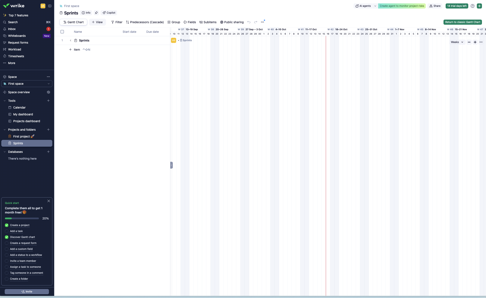

Starting point: a "Sprints" project with nothing in it yet — no sprints, no tasks, just an empty Gantt grid waiting for the first item.

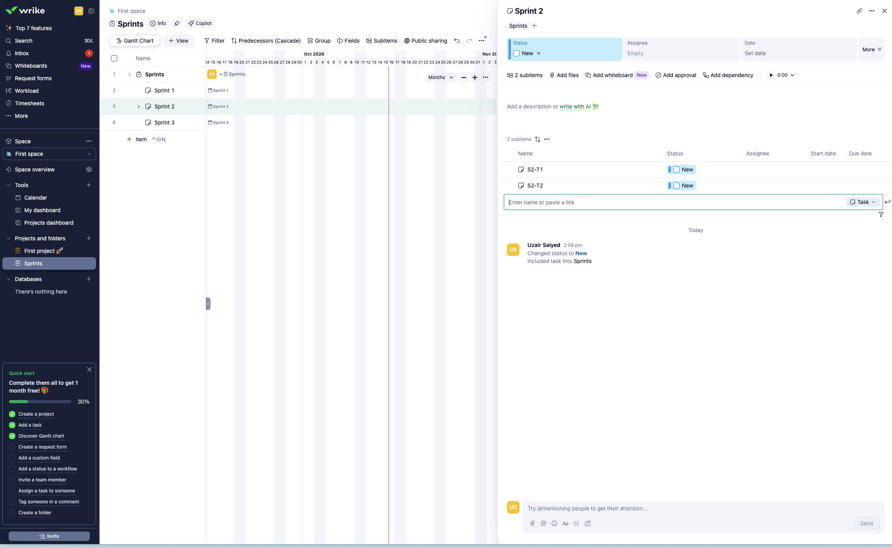

Opening Sprint 2 with its two subitems (S2-T1, S2-T2) already added shows an "Add dependency" link sitting unused in the panel, alongside Status, Assignee, and Date fields — all still empty. This is the state before any blocker relationship exists.

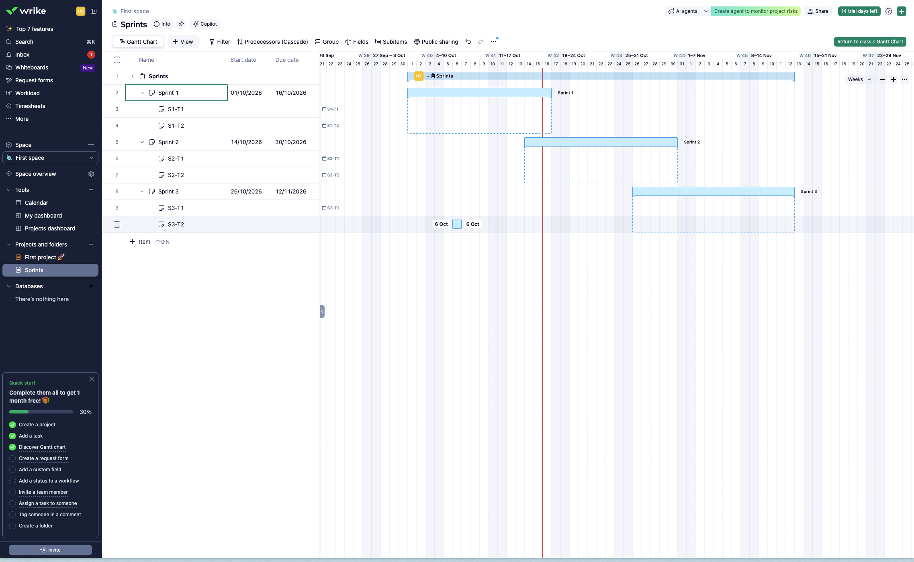

Once all three sprints have dates, the chart shows three bars with dashed boxes grouping each sprint's children underneath — no dependency arrows between them yet.

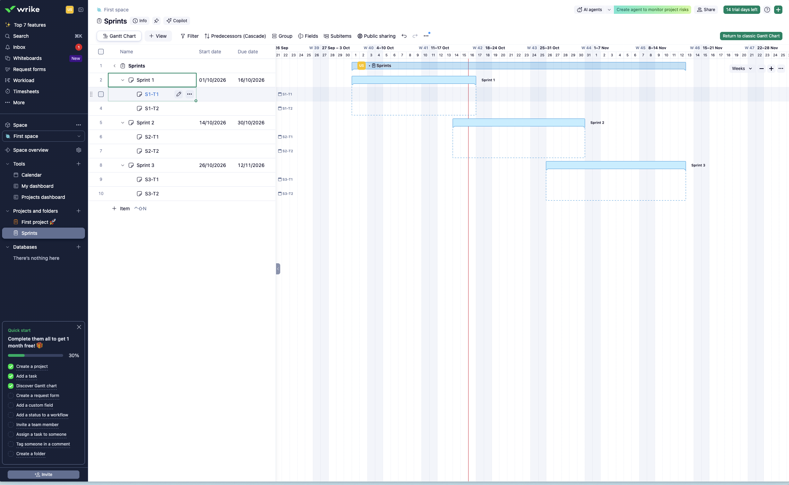

Hovering S1-T1's row reveals a small pencil (edit) and a `...` (more actions) icon next to the task name — the same row-hover pattern seen in Jira and ClickUp.

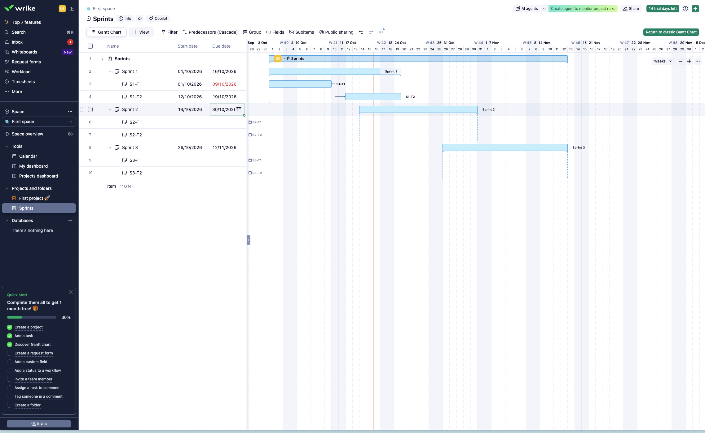

Here's the actual behavior asked about directly: edit one task's due date, and Wrike doesn't silently ripple the change through every dependent task. A banner appears first — "Apply the rules of date alignment to the affected tasks?" — with Apply and a help link, while the edited date field itself is shown mid-edit, highlighted red. Wrike has already worked out what would change, and is waiting for a yes before it touches anything else. That's a specific, deliberate design choice: compute the cascade, but ask before committing it, rather than ClickUp's approach of just doing it.

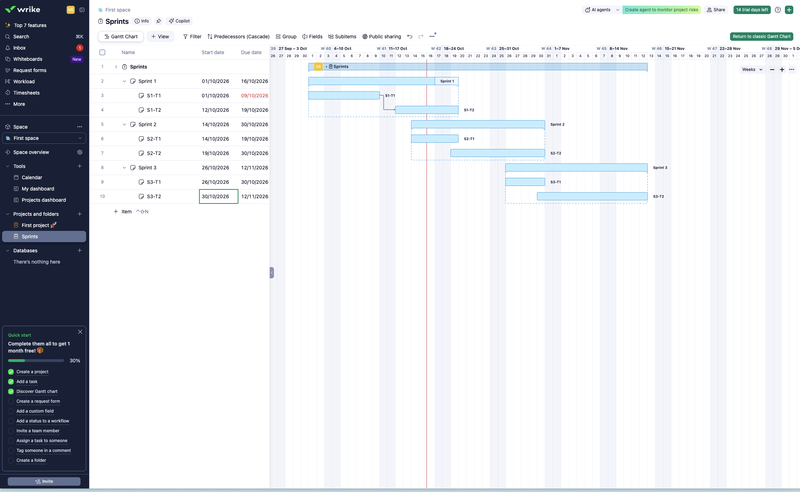

Hit Apply, and the grid updates for real: S1-T2 picks up new Start/Due dates derived from S1-T1's new due date, and the dependency arrow between them is now drawn on the chart.

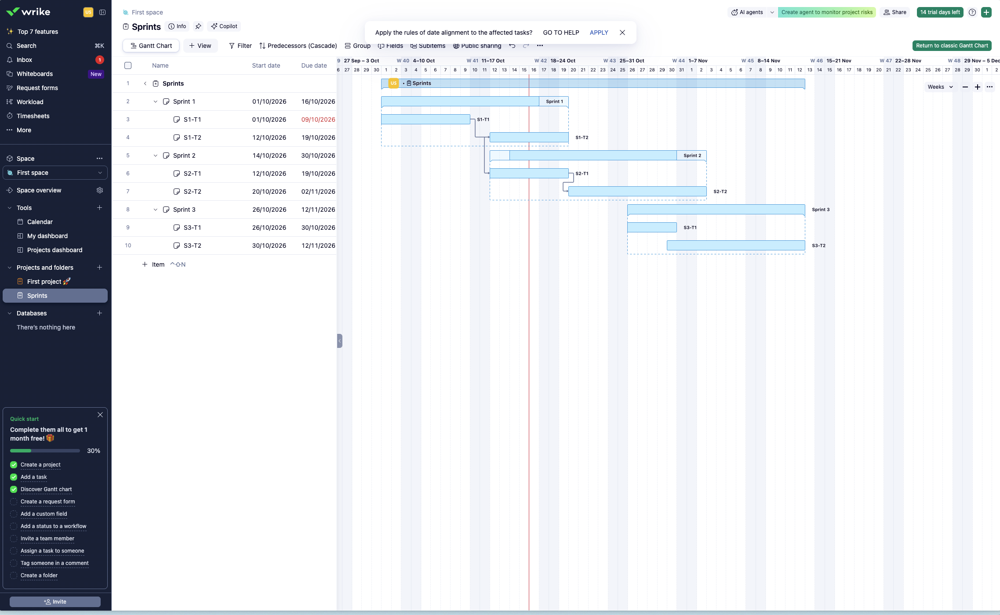

Editing a date further down the chain triggers the same "Apply the rules of date alignment" prompt a second time — and by this point the ripple has already reached S2-T1 in a different sprint entirely (its dates shift from 14–19 Oct to 12–19 Oct in the grid), confirming the cascade is designed to cross sprint boundaries, not stop at one.

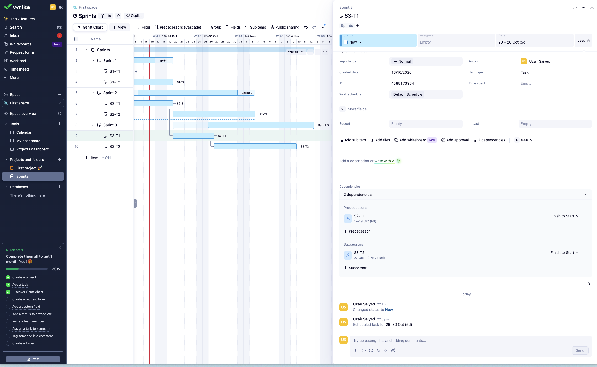

Open S3-T1's task panel and its dependencies show up as two separate, named lists: Predecessors (what this task waits on) and Successors (what waits on this task). Each entry shows the linked task's own computed date range and duration right there — "S2-T1, 12–19 Oct (6d)" — plus a dropdown to set the relationship type (Finish to Start, Start to Start, and so on) per link. This is the most complete dependency UI seen anywhere in this research: you don't have to go find the other task to know when it runs, the date is already sitting next to its name.

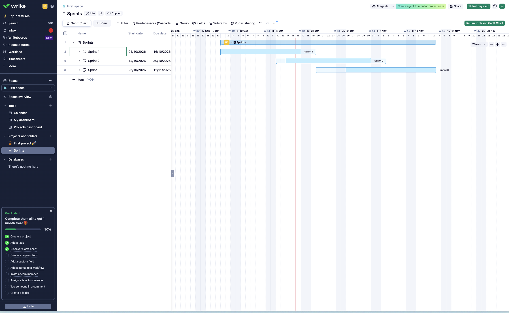

Collapsing all three sprints shows each one as a single top-level bar, same group-row pattern seen in Jira and ClickUp.

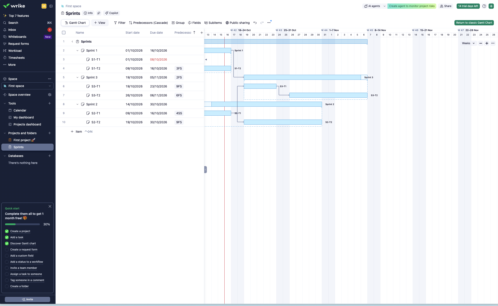

Wrike also accepts the same spreadsheet-style shorthand Smartsheet uses — a "Predecessor" column where a cell reads something like `3FS` (row 3, finish-to-start) or `4SS` (row 4, start-to-start). Type the code, and the same arrows that dragging would have drawn show up on the chart automatically. Two ways to set the same relationship, one data model underneath.

One detail worth sitting with: in this same screenshot, Sprint 3's row itself (not one of its tasks) carries a predecessor pointing at Sprint 1 (`2FS`). A whole sprint can wait on another whole sprint finishing, not just task-to-task. Nobody else surveyed showed a group-level dependency like that.

A conflict-monitor-style turn-red-and-check-dates-match feature wasn't triggered anywhere in this batch — still unverified, see the note above.

One other screenshot from this batch (`10` in the assets folder) is a near-duplicate of the apply-date-alignment prompt above, same moment captured twice — not reproduced separately.

## Classic Gantt view (screenshot, 2026-10-16)

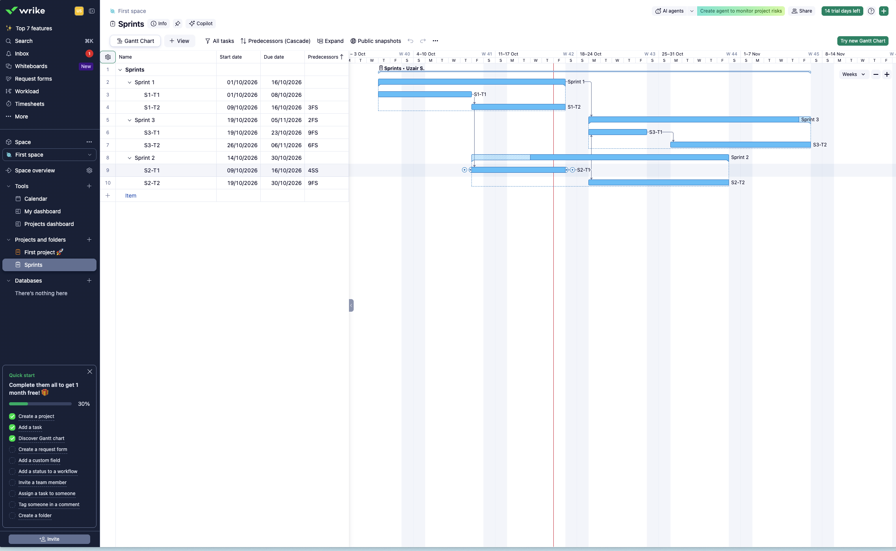

Same data, the older view. A few real differences from the one above, not just a reskin:

The "Predecessors" column sits in the table by default here, no need to add it through a Fields menu — in the newer view it only showed up because of the shorthand entry. Dependency lines are drawn as proper elbow arrows with arrowheads, routed at right angles between bars, instead of the newer view's softer curves. The date grid runs down to single days (a letter per day: S M T W T F S) alongside the week numbers, denser than the newer view's week-only header. Each sprint group row carries its own color-outlined bar plus an owner name right on the bar itself ("Sprints · Uzair S."), and small circular drag handles sit visibly at both ends of a selected bar rather than only appearing on hover.

One more thing worth a closer look later: Sprint 2's group bar renders with a diagonal hatch pattern over part of its length, where the newer view just showed a plain dashed outline for the same sprint. Sprint 2's own dates run 14–30 Oct, but its child S2-T1 actually starts 9 Oct — before the sprint it belongs to officially begins. The hatching looks like it's flagging exactly that mismatch, a child scheduled outside its parent's stated range, though this wasn't confirmed by hovering it for a tooltip. Worth testing directly rather than taking this as fact.

This is useful mainly as a reminder that "the Gantt chart" isn't one fixed set of decisions even within a single competitor — Wrike itself ships two different takes on density, line style, and what's a default column versus an opt-in one, and keeps both around.

## Sources

- [Gantt Chart in Wrike](https://help.wrike.com/hc/en-us/articles/210323585-Gantt-Chart-in-Wrike)
- [Conflict Monitor on Gantt Chart](https://help.wrike.com/hc/en-us/articles/1500005225262-Conflict-Monitor-on-Gantt-Chart)
- [Highlight Individual Dependency Chain on Gantt View (feature request)](https://help.wrike.com/hc/en-us/community/posts/1500000092962-Highlight-Indiviudal-Dependency-Chain-on-Gantt-View)
